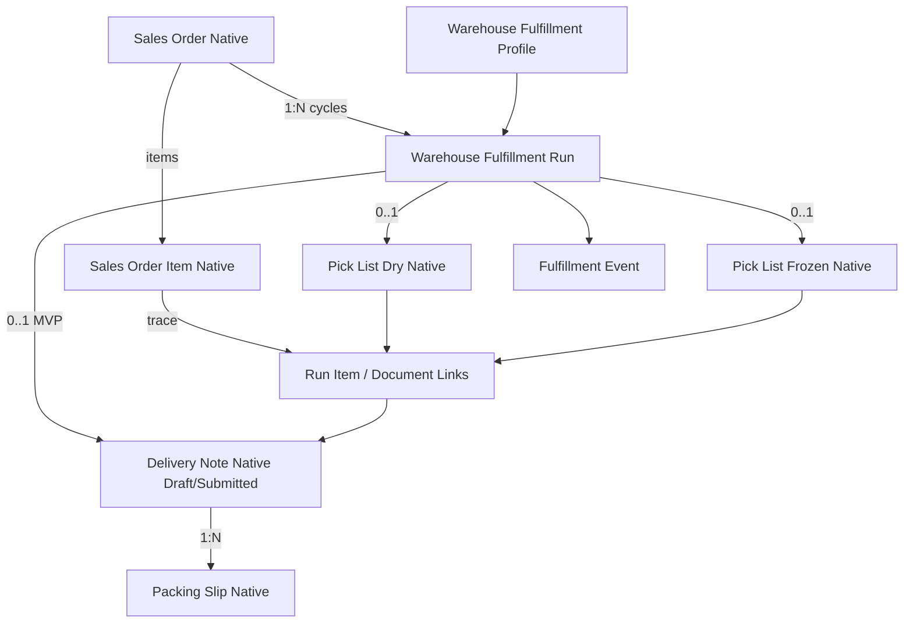

# PRODUCT REQUIREMENTS DOCUMENT (PRD)
# Warehouse Fulfillment — Native Sales Order → Dry/Frozen Pick List → Packing Slip → Delivery Note

**Produk:** Warehouse App — Fulfillment Module  
**Repository upstream:** https://github.com/Muhayustrid/warehouse-app  
**Repository implementasi (fork):** https://github.com/callmevan1120/warehouse-app  
**Base commit:** `a69511d5da87197365ea715e42a92f98066c129c` (`main`, 21 Oktober 2026)  
**Platform:** Frappe Framework / ERPNext v16  
**Jenis dokumen:** PRD + Functional Specification + Technical Design Baseline  
**Bahasa:** Indonesia  
**Versi PRD:** 1.0.1 — Draft implementasi (baseline repo fork)  
**Tanggal:** 26 Oktober 2026  
**Status:** Siap direview oleh Product Owner, gudang, dan engineering; belum merupakan konfirmasi implementasi  
**Target:** Ekstensi modul pada custom app `warehouse_app` yang sudah ada, bukan aplikasi baru.

> **Keputusan wajib (locked):** Gunakan transaksi native ERPNext: `Sales Order`, `Pick List`, `Packing Slip`, dan `Delivery Note`. Picking dipisah menjadi **Dry** dan **Frozen** berdasarkan **Item Group**. Item di grup **Produk Jadi Pabrik** (beserta turunannya jika opsi aktif) masuk **Frozen**; seluruh grup lainnya masuk **Dry**. Identitas grup Frozen berasal dari **konfigurasi**, bukan string hardcode. Cetakan Dry dan Frozen **terpisah otomatis dalam arti dipilihkan per grup**, dengan Print Format yang dapat dikonfigurasi. Tidak boleh ada hardcode nama Item, Item Group, Company, Warehouse, outlet, role, dokumen, threshold, maupun printer. Tidak memodifikasi core ERPNext.

> **Baseline repo (26 Oktober 2026):** Implementasi dikerjakan di fork `callmevan1120/warehouse-app`; upstream `Muhayustrid/warehouse-app` hanya dibaca dan tidak diubah. Base `main` = `a69511d`. Repo memiliki `AGENTS.md`: jangan edit core Frappe/ERPNext, custom field lewat `upgrade.py` idempoten, commit di `main` lokal, push/merge hanya atas persetujuan user. Dokumen ini disimpan di root repo sebagai sumber acuan; salinan di luar repo bukan sumber kebenaran.

---

## 0. Cara membaca dokumen

- **MUST / wajib:** syarat rilis dan tidak boleh dikompromikan.
- **SHOULD / disarankan:** target desain; dapat ditunda dengan alasan tertulis.
- **MAY / opsional:** tidak menjadi syarat MVP.
- **Native:** field, status, validasi, dan controller standar ERPNext v16.
- **Fulfillment Run:** catatan orkestrasi non-stock dalam custom app, bukan pengganti Sales Order/Pick List/Delivery Note.
- **Picking group:** label operasional `Dry` / `Frozen`, bukan `Item Group` baru.
- **Referensi:** sumber dokumentasi ERPNext dan repo tercantum di bagian 31.

**Batas verifikasi:** Rancangan ini berdasar dokumentasi publik ERPNext dan snapshot `main` fork implementasi per 26 Oktober 2026 (`a69511d`). Upstream `Muhayustrid/warehouse-app` pada commit yang sama; branch/working tree produksi dapat mengandung perubahan yang belum dipush. Nama fungsi internal, signature controller, hooks, field JSON, dan perilaku custom W31 wajib diuji pada instance ERPNext **v16 yang benar-benar terpasang** sebelum finalisasi technical design atau deployment. Contoh endpoint, struktur folder, dan model DocType di sini adalah desain yang diusulkan, bukan klaim semuanya sudah ada.

---

## 1. Ringkasan eksekutif

Gudang memerlukan satu antarmuka terpadu untuk memproses Sales Order yang datang dari outlet. Saat ini pekerjaan berpindah dari Sales Order, Pick List, Packing Slip, dan Delivery Note. Perpindahan layar, penentuan barang Dry/Frozen secara manual, pencetakan daftar yang tercampur, dan pencatatan jumlah menimbulkan risiko salah ambil, salah kemas, duplikasi dokumen, salah batch, dan salah pengiriman.

Solusi: modul **Warehouse Fulfillment** pada SPA `/gudang` milik `warehouse_app`, berisi Order Queue, Picking Workspace, Packing Workspace, Verification, Delivery, Print Center, riwayat dan Settings. Semua operasi backend menggunakan controller dan permission native ERPNext; app menambahkan orkestrasi, pengelompokan, print dan pengaman.

**Contoh alur:**

```text
Sales Order (Submitted)
  → [Warehouse Fulfillment Run]
  → [Klasifikasi Item berdasarkan Item Group native]
  ├─ Pick List native: Dry       → Print Format Dry
  └─ Pick List native: Frozen    → Print Format Frozen
  → Picking selesai + verifikasi kedua jalur
  → Delivery Note native (Draft) hasil konsolidasi yang tervalidasi
  → Packing Slip native (per kemasan/kardus)
  → Verifikasi packing dan pengiriman
  → Delivery Note native (Submit) → Stock Ledger ERPNext
  → Handoff ke Logistics Management (integrasi terpisah)
```

**Aturan penting:** Dua Pick List tidak berarti dua Delivery Note. Target MVP adalah **satu DN per Fulfillment Run** bila satu Customer/Company/tujuan dan seluruh data konsisten. Jika terjadi split sah karena alasan akuntansi/operasional, tampilkan exception dan gunakan jalur terkontrol; jangan membuat DN diam-diam. **Satu Sales Order dapat memiliki beberapa Fulfillment Run dari waktu ke waktu** jika ada pengiriman parsial, tanpa kuantitas dobel.

### 1.1 Nilai bisnis

1. Memisahkan pekerjaan Dry dan Frozen dari satu Sales Order tanpa memecah pesanan komersial.
2. Menghasilkan **Pick List dan cetakan berbeda** untuk petugas/area berbeda.
3. Menyatukan pekerjaan picking, packing, verification, dan DN di satu UI.
4. Mempertahankan ledger, audit, permission, serial/batch, pajak, dan status native.
5. Mencegah double-click, refresh, dua user, perubahan SO, dan pengiriman ganda.
6. Mendukung ekspansi pengiriman outlet tanpa hardcode item atau struktur organisasi.

---

## 2. Latar belakang dan konteks operasional

### 2.1 Model bisnis

- Pabrik menjual/mengirim item ke outlet.
- Dalam model intercompany saat ini, setiap outlet adalah **Company** tersendiri; penjual/pabrik juga Company tersendiri. Pemilihan `Company` DN tetap **Company penjual**. Customer di sisi pabrik menunjuk outlet sebagai pembeli; mapping ke Company outlet adalah proses intercompany/logistik terpisah.
- Sales Order pabrik menjadi referensi pemenuhan barang.
- Kategori picking bisnis:
  - **Frozen**: produk jadi pabrik, misalnya dough roti keju coklat butter, dough gempi, dough croissant, dan krim kopi.
  - **Dry**: semua item pada Item Group selain grup produk jadi pabrik yang dipilih dalam pengaturan.
- Nama produk di atas **hanya contoh**, bukan daftar tertanam dalam aplikasi dan bukan kondisi pemrograman.
- Fitur existing `warehouse_app` (Requests/Inventory/proses serah terima produksi) harus tetap berfungsi.

### 2.2 Masalah saat ini

| ID | Masalah | Dampak |
|---|---|---|
| P-01 | Dokumen saling terhubung tetapi UI tersebar | Banyak klik, training sulit |
| P-02 | Picking Dry dan Frozen bercampur | Salah area, sorting manual |
| P-03 | Print Pick List tidak otomatis per kategori | Petugas memisahkan kertas manual |
| P-04 | Qty, UOM, batch berbeda antar-tahap | Selisih dan penundaan |
| P-05 | Tidak ada tampilan readiness gabungan | DN prematur atau barang tertinggal |
| P-06 | Pengguna dapat membuat duplikasi | Picking/DN ganda |
| P-07 | Proses dua orang bersamaan dapat saling overwrite | Kehilangan progres |
| P-08 | Penentuan kategori mungkin berubah | Riwayat picking tidak konsisten |
| P-09 | Setup printer, gudang, hak akses bersifat lokal | Maintenance mahal bila di-hardcode |

---

## 3. Tujuan, hasil, dan KPI

### 3.1 Tujuan fungsional

- T-01: Operator bisa memproses Sales Order dari satu halaman tanpa harus berpindah ke form ERPNext dalam alur normal.
- T-02: Klasifikasi Dry/Frozen **100% berasal dari Item Group native + pengaturan**.
- T-03: Sistem membuat 0–1 Pick List Dry dan 0–1 Pick List Frozen **per grup per Run**; grup kosong tidak dibuatkan dokumen.
- T-04: Dua jalur bisa dikerjakan terpisah, namun DN tidak boleh meloloskan item yang belum siap.
- T-05: Print setiap grup memilih format sesuai konfigurasi, bukan format yang diketik di kode.
- T-06: Tidak ada pengurangan stok sampai Delivery Note di-Submit oleh ERPNext.
- T-07: Semua perubahan penting meninggalkan jejak audit dan referensi dokumen native.
- T-08: Mendukung pengiriman parsial terkendali tanpa melebihi sisa SO.

### 3.2 Target operasional awal (hipotesis, divalidasi baseline)

| Metrik | Target uji pilot | Sumber ukur |
|---|---|---|
| Duplikasi Pick List akibat double-click | 0 | Idempotency log + dokumen |
| DN terkirim melebihi hak SO | 0 | Rekonsiliasi baris SO/DN |
| Item salah grup akibat software | 0 | Audit klasifikasi |
| Cetak Dry/Frozen yang tercampur | 0 | QA PDF |
| Pengiriman tanpa verifikasi wajib | 0 | Event log |
| Konsistensi qty Pick→Pack→DN | 100% atau exception approved | Rekonsiliasi |
| Performa buka antrean 100 SO | p95 ≤ 3 detik pada lingkungan pilot | Observability |
| Availability UI selama jam operasional | target 99,5% (perlu persetujuan SLA) | Monitoring |

SLA teknis bukan garansi sebelum benchmark pada data dan infrastruktur nyata.

---

## 4. Prinsip desain non-negotiable

1. **Native-first.** Sales Order, Pick List, Packing Slip, Delivery Note, Stock Ledger Entry, Sales Invoice, serta pembukuan tetap milik ERPNext.
2. **No hardcoded business values.** Tidak ada `item_group == "Produk Jadi Pabrik"` atau daftar nama dough di backend/frontend. Nama tampilan Dry/Frozen, Print Format, warehouse, Company, roles, thresholds, dan policy diambil dari Settings. Identifier teknis stabil `dry`/`frozen` hanya merepresentasikan dua cabang proses, **bukan** kondisi Item Group, lokasi, atau daftar produk. Perubahan label user tidak boleh mengubah mapping historis.
3. **Tidak memodifikasi core.** Implementasi dalam `warehouse_app`, custom DocType/configuration serta hooks/fixtures idempoten. Jangan mengubah `production_app` atau perilaku pengguna Desk native secara global.
4. **Baca-permission dahulu.** Frontend tidak menjadi sumber otorisasi.
5. **Fail closed.** Bila konfigurasi Frozen tidak terisi/invalid, klasifikasi tidak berjalan. Tidak boleh diam-diam semua menjadi Dry.
6. **One source of truth.** Qty stok & ledger dari ERPNext. `Fulfillment Run` tidak memuat saldo stok tandingan.
7. **Atomic operations + replay safe.** Aksi mutasi punya transaction boundary dan idempotency key.
8. **Traceability.** Hubungkan setiap qty ke `Sales Order Item`, Pick List Item, lokasi/batch, dan Delivery Note Item.
9. **Upgrade-compatible.** Hindari mengikat diri ke private API ERPNext tanpa integration tests; bila private API terpaksa dipakai, buat adapter terisolasi.
10. **Operator friendly.** Masing-masing peran melihat hanya tugas dan aksi yang relevan.

---

## 5. Scope

### 5.1 In scope (MVP)

- Order Queue hanya untuk Sales Order eligible dan dapat diakses oleh Company yang diizinkan.
- Settings per Company (pabrik) dengan Frozen Item Group, opsi child groups, sumber warehouse, print format, kebijakan partial, verifikasi, scanner.
- Klasifikasi baris SO: Dry vs Frozen; snapshot klasifikasi pada setiap Run.
- Pembuatan dua Pick List native (maksimal satu per grup per Run) dan pemulihan/resume jika proses terganggu.
- Picking progres terpisah; batch/serial, gudang, UOM, scan barcode mengikuti native ERPNext + kompatibilitas W31.
- Print Dry dan Frozen terpisah, Print All, preview, reprint audit.
- Konsolidasi dua Pick List menjadi satu DN Draft tervalidasi.
- Pembuatan banyak Packing Slip native untuk kardus/kemasan.
- Verification akhir sebelum Submit DN.
- Status dan audit, exception handling, role permissions.
- Pencarian/pagination, filter, empty state, UI desktop/tablet dan dukungan keyboard.
- Testing unit, integrasi, E2E, regresi W31, rollout dan rollback.

### 5.2 Post-MVP / future

- Wave picking lintas banyak SO/outlet.
- Put-away/slotting lanjutan, integrasi timbangan, pengukuran suhu frozen/cold-chain, photo evidence.
- Auto-print ke printer tertentu tanpa browser dialog melalui print server.
- Route/vehicle loading dan Proof of Delivery oleh Logistics Management.
- QR label setiap kardus, mode offline scanner dengan conflict resolution.
- Optimasi jadwal order dan replenishment.
- Analitik SLA per petugas/shift dan kapasitas gudang.

### 5.3 Out of scope

- Membuat ulang proses Sales Order, DN, packing, posting stock dan stock valuation.
- Mengubah Purchase Order/Purchase Receipt di Company outlet.
- Otomatis Submit Purchase Receipt atas laporan driver (menjadi milik Logistics Management).
- Mengatur invoice, pembayaran, pajak intercompany.
- Memasukkan daftar item pabrik sebagai aturan default kode.
- Mengubah aturan Stock Reservation native secara global.

---

## 6. Persona, peran, dan tanggung jawab

| Persona | Kegiatan | Hak minimal yang disarankan |
|---|---|---|
| Admin Fulfillment | Konfigurasi Item Group, warehouse, format, policy, roles | Setting + audit |
| Order Coordinator | Pilih SO, generate picking, pantau seluruh order | Read SO, Create/Read Pick List melalui backend terotorisasi |
| Dry Picker | Ambil item Dry dan laporkan picked qty | Hak Pick List scope Dry |
| Frozen Picker | Ambil item Frozen dan laporkan picked qty | Hak Pick List scope Frozen |
| Packer | Kelola box dan Packing Slip | Read DN Draft, Create/Submit Packing Slip |
| Checker/Supervisor | Verifikasi selisih, approve pengecualian | Hak verifikasi, approve sesuai konfigurasi |
| Dispatch Supervisor | Submit DN / serahkan ke logistics | Submit DN native, scope Company |
| Auditor | Lihat histori, alasan selisih, cetak/reprint | Read only, tanpa mutasi |
| System Administrator | Recovery, konfigurasi, support | Frappe administrator sesuai kontrol organisasi |

**Catatan:** Nama role pada tabel adalah usulan. Actual Role dipilih melalui Link Role di konfigurasi atau Role Permission Manager. Jangan memberikan hak admin ke picker atau mengandalkan filter frontend sebagai keamanan. Pisahkan `create`, `write`, `submit`, `cancel`, `print`, dan `approve`.

---

## 7. Aturan klasifikasi Dry/Frozen

### 7.1 Keputusan bisnis final

- Seluruh item pada Item Group **Frozen Item Group terpilih** masuk **Frozen**.
- Seluruh item pada Item Group lain masuk **Dry**.
- Untuk sekarang pilihan Frozen Item Group = **Produk Jadi Pabrik** sebagai nilai konfigurasi pengguna.
- Jika `include_child_item_groups = true`, Item Group turunannya juga Frozen.
- Tidak menggunakan Item Name, Item Code prefix, Brand, item-wise override, atau aturan kategori multi-level custom.
- Tidak perlu custom field tambahan pada `Item` untuk label Dry/Frozen.

### 7.2 Algoritme deterministik

```text
classify(item, profile):
  assert profile.enabled and profile.frozen_item_group exists
  assert item exists and item.item_group exists
  frozen_set = {configured group}
  if profile.include_child_item_groups:
      frozen_set += descendants(configured group) [native nested-set Item Group]
  return FROZEN if item.item_group in frozen_set else DRY
```

**Implementasi:** query Item Group tree Frappe secara aman, jangan memakai prefix atau nama string. Validasi bahwa Item Group tersebut ada dan tidak salah Company (Item Group biasanya master bersama). Cache hanya untuk tampilan, dibatalkan saat perubahan Settings/Item Group, dan hitung ulang saat Generate.

### 7.3 Snapshot dan perubahan master

- Saat Preview: tampilkan hasil klasifikasi terbaru sebagai **preview belum dipersist**.
- Saat Generate Run: simpan versi konfigurasi/revisi, link Frozen Item Group dan mapping `SO Item row ID → group` pada catatan Run/child record, beserta audit tanggal/operator.
- Jika Item Group berubah setelah Run dibuat, **Run aktif mempertahankan grup semula**. Perubahan dibaca pada Run baru, kecuali manajer menjalankan `Rebuild` dengan kondisi aman (belum Submit PL, belum Packing/DN), yang membatalkan draft lama dan menghasilkan snapshot baru sesuai kontrol versi.
- Jika pengguna mengganti grup konfigurasi Frozen, tampilkan estimasi dampak dan larang perubahan retroaktif terhadap Runs berjalan.

### 7.4 Edge cases

| Kondisi | Perlakuan |
|---|---|
| Frozen Item Group belum dipilih | Blokir Generate, arahkan ke Settings |
| Item belum punya Item Group | Blokir baris dan tampilkan error master data |
| Item Group parent Frozen dan anak lain | Child ikut Frozen bila flag aktif |
| Item di luar Frozen | Dry, tidak perlu mapping khusus |
| Item non-stock pada SO | Tidak dibuat Pick List; tampilkan sebagai `Not Pickable` dan kebijakan handling/DN native (lihat §15) |
| Product Bundle | Komponen stock dan referensi bundle harus diproses sesuai native mapper; jangan hanya klasifikasi parent tanpa verifikasi detail |
| Item disabled setelah SO | Tampilkan exception dan validasi native; tidak boleh diam-diam dilewati |
| Rename Item Group | Link Frappe mengikuti rename; tampilkan nilai baru dari database |
| Item di-pindahkan group setelah PL Submit | Snapshot tetap; tidak mengubah dokumen native yang telah dibuat |

---

## 8. Hubungan dengan ERPNext native

| Dokumen | Sumber | Tindakan custom app | Stock Ledger |
|---|---|---|---|
| Sales Order | ERPNext selling | Baca SO eligible + outstanding lines | Tidak mengurangi stok |
| Pick List (Dry) | Native ERPNext | Buat/ubah/Submit sesuai controller | Tidak mengurangi stok |
| Pick List (Frozen) | Native ERPNext | Buat/ubah/Submit sesuai controller | Tidak mengurangi stok |
| Delivery Note Draft | Native ERPNext | Gabungkan hasil dua PL, isi referensi | Tidak mengurangi stok |
| Packing Slip | Native ERPNext | Buat dari DN Draft, per kardus | Tidak mengurangi stok |
| Delivery Note Submitted | Native ERPNext | Submit hanya setelah gate lulus | Mengurangi stok sesuai native |
| Logistics Handoff | App logistik lain | Hanya menyediakan referensi DN | Tidak mem-post stok pabrik ulang |

ERPNext resmi mensyaratkan Pick List `Purpose = Delivery` untuk Sales Order dan DN dibuat dari Pick List yang sudah Submit. Packing Slip berasal dari **DN Draft**; beberapa Packing Slip dapat berhubungan ke satu DN. Native Packing Slip menautkan item ke baris DN dan memperbarui `packed_qty`. Kontrak konsolidasi **dua Pick List menjadi satu DN** adalah tanggung jawab service baru; **bukan fitur merge yang boleh diasumsikan disediakan otomatis oleh tombol standar**.

### 8.1 Pengaruh W31 existing

Repository `warehouse_app` telah memiliki kustomisasi **W31** pada Pick List: `custom_picked_qty` (as per UOM), konversi ke picked stock quantity, batch entry support, barcode scanner adaptation, hooks, dan gate role. Implementasi baru MUST:

- Audit field, `before_validate`, `on_submit`, client script, scanner, dan jenis role W31 di working tree terkini.
- **Reuse** quantity conversion / helpers valid, jangan menduplikasi algoritme.
- Tidak mengoverride JS scanner global dengan patch baru tanpa regression test.
- Menangani beda `stock_qty`, `picked_qty`, `custom_picked_qty` dan `conversion_factor` secara eksplisit.
- Menjaga kerja normal Pick List dari Desk native untuk user yang bukan pengguna fulfillment.
- Menjalankan gate tests W31 dan E2E barcode sebelum merge.

---

## 9. Alur bisnis end-to-end (happy path)

### 9.1 Prasyarat

1. ERPNext v16 terpasang dan `warehouse_app` terinstall.
2. Company pabrik mempunyai Fulfillment Profile aktif.
3. Frozen Item Group dipilih melalui UI; contoh nilai: Produk Jadi Pabrik.
4. Print Format masing-masing Dry dan Frozen diatur.
5. Source Warehouse/parent warehouse pada profil valid untuk Company pabrik.
6. User memiliki permission SO, PL, DN, PS sesuai perannya.
7. Item dan UOM/stock/batch sesuai kebutuhan.
8. Sales Order berstatus Submit, bukan Closed/Cancelled/Hold, dan masih ada quantity to deliver.

### 9.2 Detail alur

**A. Order Queue**

1. Operator memilih Company (default sesuai akses) dan filter status/tanggal/customer/SO.
2. Backend mengembalikan SO eligible dengan counts Dry/Frozen, stock warning, progress dan outstanding deliverable.
3. Klik SO → lihat item, Item Group, group result, qty order/delivered/allocated/remaining, warehouse dan potensi exception.
4. Klik `Generate Pick Lists`. Backend memvalidasi ulang dan membuat/menemukan Fulfillment Run yang relevan, snapshot, lalu dokumen Dry dan/atau Frozen.
5. UI menampilkan link native dan nomor Pick List per grup.

**B. Picking Dry dan Frozen**

1. Masing-masing tab menunjukkan lokasi, Item Code/Name, UOM, target, picked, batch/serial, status.
2. Operator dapat mencetak PL sesuai grup sebelum berjalan ke area stok.
3. Operator scan barcode atau mengisi qty aktual sesuai policy dan permission.
4. Server melakukan validasi stock-UOM, tolerance ERPNext, batch/serial, lokasi, dan perubahan versi.
5. Operator menyimpan progres. Penyelesaian grup terjadi dengan submit native PL sesuai kebijakan short pick.
6. Dry dan Frozen dapat selesai dalam urutan berbeda; status keduanya terpisah.

**C. Delivery Preparation**

1. Saat semua grup yang diwajibkan telah selesai, sistem melakukan rekonsiliasi picked qty per SO Item, group, batch/warehouse/serial.
2. `Create Delivery Note Draft` melakukan konsolidasi terkontrol dari PL Dry + Frozen, mempertahankan per-row referensi SO dan stock constraints.
3. Simpan DN Draft via native controller dan tautkan ke Run. Jangan Submit.

**D. Packing**

1. Packer melihat setiap item DN dan sisa belum dipacking.
2. Membuat `Package 1, Package 2, ...` dengan isi, qty, bobot (jika tersedia), identitas kemasan.
3. Setiap package menghasilkan Packing Slip **native** dengan referensi DN Draft/child row yang benar.
4. Tidak boleh pack qty > DN qty. Completion gate harus membandingkan total packed qty dengan qty yang akan dikirim.

**E. Verification & Dispatch**

1. Checker melihat tabel SO ordered, remaining, Dry picked, Frozen picked, DN draft qty, packed qty dan exception.
2. Checker menyetujui atau mengembalikan pekerjaan dengan alasan.
3. Dispatch Supervisor melakukan Submit Delivery Note native.
4. Backend mengambil status hasil Submit dari ERPNext, lalu menandai Run `Dispatched` dan mempublikasikan referensi ke sistem logistik (bila diaktifkan).
5. Setelah Submit DN, Stock Ledger Entry menjadi otoritas atas stok keluar.

---

## 10. Flow status dan lifecycle

### 10.1 Status tingkat Fulfillment Run (status aplikasi)

```text
NEW / PLANNING
    ↓
PICKING_IN_PROGRESS
    ├── DRY_PENDING / DRY_IN_PROGRESS / DRY_DONE / DRY_EXCEPTION
    └── FROZEN_PENDING / FROZEN_IN_PROGRESS / FROZEN_DONE / FROZEN_EXCEPTION
    ↓ [semua grup applicable selesai atau partial approved]
PICKED
    ↓
DN_DRAFT
    ↓
PACKING_IN_PROGRESS
    ↓
READY_FOR_VERIFICATION
    ↓
VERIFIED
    ↓
DISPATCHED [DN native docstatus=1]
```

Status pengecualian: `ON_HOLD`, `NEEDS_RECONCILIATION`, `FAILED_RETRYABLE`, `CANCELLED`, `CLOSED_PARTIAL`. Semua harus memiliki audit reason dan dapat dipulihkan sesuai workflow. **Status aplikasi derived/reconciled dari dokumen native**, bukan di-set secara optimistis sebelum hasil server berhasil.

### 10.2 Invarian

- `DISPATCHED` hanya jika DN native `docstatus = 1`.
- `VERIFIED` hanya jika DN Draft valid dan quantity completeness sesuai policy.
- `DRY_DONE` hanya jika Pick List Dry native valid/Submit atau status grup non-applicable.
- `FROZEN_DONE` analog.
- DN Draft tidak boleh berisi item dari SO lain tanpa eksplisit extension feature.
- DN tidak memuat batch/warehouse yang tidak ada di sumber picking tanpa mekanisme koreksi approved.
- Tidak ada dua DN Submit terhadap stok picked unit yang sama.

---

## 11. Functional Requirements — Order Queue

| ID | Prioritas | Kebutuhan | Acceptance |
|---|---|---|---|
| FR-001 | P0 | Menu Fulfillment dalam sidebar SPA `/gudang` | Tidak mengubah routing Requests/Inventory |
| FR-002 | P0 | List Sales Order eligible per allowed Company | SO cancelled/closed/fully delivered tidak dapat di-generate |
| FR-003 | P0 | Filter SO, customer/outlet, tanggal, Company, status, group, exception | Filter server-side, pagination |
| FR-004 | P0 | Preview detail item dan kelas Dry/Frozen dari Item Group | Hasil cocok dengan konfigurasi dan Item Group tree |
| FR-005 | P0 | Preview outstanding qty per SO child row, bukan hanya Item Code | Tidak double-count item yang muncul dua kali |
| FR-006 | P0 | Status progress Run (Dry/Frozen/Packing/DN) | Konsisten setelah refresh |
| FR-007 | P0 | Generate Pick Lists idempoten | Request diulang menghasilkan referensi sama |
| FR-008 | P1 | Sort prioritas/due date/outlet (native fields) | Tanpa hardcode prioritas outlet |
| FR-009 | P1 | Alert perubahan SO, stok, master group | Proses dikunci/rekonsiliasi saat perlu |
| FR-010 | P1 | Resume Run yang belum selesai | Tidak membuat dokumen baru |

**Order eligibility:** harus memperhitungkan `docstatus`, `status`, `delivery_status/per_delivered` atau field native v16 yang relevan, `Sales Order Item` outstanding, dan outstanding yang sudah dialokasikan di Fulfillment Run lain. Jangan semata-mata memakai `per_picked` karena hasil picking bisa belum menjadi DN dan perhitungan dapat berbeda dari delivery.

---

## 12. Functional Requirements — Generate Native Pick Lists

| ID | Prioritas | Kebutuhan | Acceptance |
|---|---|---|---|
| FR-101 | P0 | Pecah SO item secara deterministik ke Dry/Frozen | Tepat satu group per eligible row |
| FR-102 | P0 | Hanya buat Pick List untuk grup yang punya qty > 0 | Tidak ada PL kosong |
| FR-103 | P0 | PL memakai `purpose=Delivery`, Company penjual, Customer dan referensi SO | Validasi native berhasil |
| FR-104 | P0 | Gunakan native controller/mapping ERPNext untuk warehouse, batch/serial, UOM | Tidak menyuntik SQL atau bypass validate |
| FR-105 | P0 | Tambahkan metadata group/run ke PL custom field atau child link | Telusur dari PL ke Run |
| FR-106 | P0 | Mencegah duplicate Generate (client/server) | Satu PL per grup per Run |
| FR-107 | P0 | Re-read quantities sebelum commit | Tidak overshoot outstanding SO |
| FR-108 | P0 | Support 1 atau 2 grup sesuai order | Dry-only/Frozen-only lulus |
| FR-109 | P1 | Pilih default source parent warehouse per grup jika dikonfigurasi | Constraint native/company valid |
| FR-110 | P1 | Retry dari kegagalan sebagian | Tidak membuat PL duplicate |
| FR-111 | P1 | Link ke PL native untuk troubleshooting | Hanya visible bagi user authorized |
| FR-112 | P1 | Tombol regenerate aman untuk draft yang belum terpakai | Ada reason/audit dan tidak melanggar linked docs |

**Strategi create:** masukkan SO row ke mapper native yang tervalidasi, lalu filter/rekonstruksi lokasi dengan API adapter sesuai versi; jangan membuat dua PL dari semua item kemudian membiarkan setiap PL menghitung SO sama. Lakukan validasi sesudah mapping karena controller ERPNext bisa memecah satu SO item ke beberapa lokasi/batch. Test kebutuhan multi-location dan shortage.

**Kegagalan 1 dari 2 PL:** batas transaksi disarankan atomic untuk Generate dua PL; jika satu gagal, seluruh pembuatan pada request itu rollback. Bila deployment/worker crash setelah commit, retry memakai idempotency record dan memulihkan referensi committed. Jangan mencampur rollback dokumen submitted dengan raw deletion.

---

## 13. Functional Requirements — Picking Workspace

| ID | Prioritas | Kebutuhan | Acceptance |
|---|---|---|---|
| FR-201 | P0 | Tab Dry/Frozen selalu terpisah | Tidak ada item cross-group |
| FR-202 | P0 | Qty order/pending/target/picked dalam UOM jelas | Tidak membingungkan stock vs transaksi UOM |
| FR-203 | P0 | Menampilkan Warehouse, Rack/bin bila tersedia, Batch, expiry, Serial | Tidak menebak lokasi |
| FR-204 | P0 | Manual qty & barcode (sesuai policy) | Scan tak dikenal ditolak |
| FR-205 | P0 | Save per-row aman terhadap concurrency | Tidak lost update |
| FR-206 | P0 | Native validation pada Submit Pick List | Kesalahan native ditampilkan jelas |
| FR-207 | P0 | Support short pick dengan reason dan approval | Tidak memalsukan picked_qty |
| FR-208 | P0 | Tunjukkan `Last Saved`, `Unsaved`, `Conflict` | Reload aman |
| FR-209 | P1 | Scanner-compatible untuk keyboard wedge | Fokus input persisten tanpa double increment |
| FR-210 | P1 | Peringatan expiry/minimum shelf-life opsional | Angka ambang dari setting, bukan hardcoded |
| FR-211 | P1 | Assigned picker per zone dan activity log | Bisa audit siapa mengambil |
| FR-212 | P1 | Pause/resume picking | Draft tersimpan tanpa submit |

**Kebijakan short pick (penting):** pada beberapa mode native ERPNext, Pick List menuntut `picked_qty` memenuhi target lokasi (`scan_mode` dapat melarang kurang). Solusinya **bukan bypass validasi**: supervisor memilih revisi target lokasi/jumlah pick secara valid sebelum Submit, atau menahan PL untuk replenishment. Sisa Sales Order tetap outstanding dan bisa diproses Run berikutnya. Implementasi wajib lulus integration test native v16, termasuk W31 `custom_picked_qty`.

**Batch/Serial:** gunakan identitas dan Serial and Batch Bundle native ERPNext v16. Verifikasi bukan hanya Item Code + qty, melainkan kombinasi `SO Item ID, PL Item ID, source warehouse, batch/serial bundle, stock UOM`. Batch FEFO/FIFO diserahkan ke ERPNext atau kebijakan configured yang memakai mekanisme native; jangan query FIFO custom secara terpisah.

---
## 14. Functional Requirements — Print Pick Lists

### 14.1 Kebutuhan dan prinsip

| ID | Prioritas | Kebutuhan | Acceptance |
|---|---|---|---|
| FR-301 | P0 | Print Dry memakai Pick List Dry native | Isi hanya item Dry |
| FR-302 | P0 | Print Frozen memakai Pick List Frozen native | Isi hanya item Frozen |
| FR-303 | P0 | Format Dry dan Frozen dapat dipilih user melalui Link `Print Format` | Tanpa perubahan kode |
| FR-304 | P0 | `Print All` memberi dua output terpisah (bila dua grup ada) | Tidak menggabungkan halaman tanpa identitas |
| FR-305 | P0 | Nomor PL, SO, Customer, tanggal, picker, gudang, item, lokasi, qty, UOM jelas | Kertas bisa dipakai di gudang |
| FR-306 | P0 | Batch/expiry/serial tercetak bila diperlukan | Field valid dari native |
| FR-307 | P0 | Cetak/reprint role-gated, audit event | Hak baca tetap dicek |
| FR-308 | P0 | Jangan membuka print untuk PL yang tak boleh diakses | Tidak bisa enumerasi endpoint |
| FR-309 | P1 | Konfigurasi paper size, orientation, letterhead, copies | Per profil/grup |
| FR-310 | P1 | Print status `Draft` secara aman bila policy mengizinkan | Route custom dengan permission, tidak melonggarkan global setting |
| FR-311 | P1 | Barcode/QR dokumen untuk scan penyelesaian | Unik & cukup besar dicetak |
| FR-312 | P2 | Direct print printer tertentu | Butuh print bridge/infrastruktur |

### 14.2 Interaksi user

- Saat dua PL selesai dibuat, user melihat **dua kartu** dengan nomor/link dan tombol `Print Dry`, `Print Frozen`.
- `Print All` menawarkan pilihan `Open two PDFs`, `Download two PDFs as ZIP` atau `Print sequentially` bila browser mendukung; default yang paling deterministik adalah **dua PDF terpisah** / ZIP.
- Untuk grup kosong: tombol Print tidak tampil, bukan membuat output kosong.
- Printer/perangkat tidak boleh ditanam di kode. Direct print dimatikan sampai print bridge terotorisasi tersedia.
- Jika Print Format dihapus, ditarik permission, atau gagal render: tampilkan error konfigurasi yang jelas; **jangan fallback diam-diam ke template lain** yang berpotensi menghilangkan batch.

### 14.3 Template cetak minimum

```text
WAREHOUSE PICKING LIST - {GROUP DISPLAY NAME}
Company: ____________     Sales Order: SO-____
Pick List: PL-________     Customer/Outlet: ______
Created: _____________     Expected Date: ________
Warehouse/Zone: ______     Picker: ______________

No | Rak/Warehouse | SKU | Item | UOM | Target | Actual | Batch/Expiry | Check
 1 | ...           | ... | ...  | ... | ...    | _____  | ...          | [ ]

Total Lines: ___  Total Qty per UOM: (gunakan grouping, bukan jumlah lintas UOM)
Picked By: ________  Time: ________
Checked By: _______  Time: ________
Document Revision: ___     QR/barcode (optional)
```

**Aturan agregasi cetak:** jangan menjumlah `10 kg + 5 pcs` menjadi 15 tanpa label. Qty total harus dikelompokkan per Stock UOM atau ditampilkan hanya jumlah baris/SKU. Satu Item dapat punya lebih dari satu row karena warehouse/batch/serial; cetakan harus menampilkan pemecahan tersebut.

### 14.4 Keamanan print

- Backend harus mengecek session, user permission, Company, keterhubungan PL ke Run, dan bahwa format terpilih diizinkan.
- Format user-editable hanya boleh dibuat/diubah oleh permission Print Format yang sah.
- HTML/Jinja print template tidak boleh menerima ekspresi tak tepercaya melalui query string; selalu gunakan template server-side yang disetujui.
- PDF dibentuk berdasarkan snapshot dokumen pada saat cetak; cetak ulang menunjukkan waktu dan reprint label jika diperlukan audit.
- Output pengunduhan memakai nama aman `PL-XXXX_DRY.pdf` dan `PL-XXXX_FROZEN.pdf` (label nama file boleh dibentuk dari display code yang disanitasi).

---

## 15. Functional Requirements — Konsolidasi Delivery Note

Ini adalah titik desain **berisiko tertinggi** dan wajib memiliki integration tests kuat.

| ID | Prioritas | Kebutuhan | Acceptance |
|---|---|---|---|
| FR-401 | P0 | Satu DN Draft dari dua PL submitted dalam Run yang sama | Semua picked eligible tercakup tepat satu kali |
| FR-402 | P0 | DN mengacu ke Sales Order dan child row benar | `against_sales_order` / `so_detail` atau field native setara benar |
| FR-403 | P0 | Warehouse & batch/serial dari hasil picking terjaga | Tidak berpindah sumber stok |
| FR-404 | P0 | UOM dan conversion factor native konsisten | Qty stock sama sebelum/sesudah mapping |
| FR-405 | P0 | Harga, pajak, income account, cost center, address, currency, sales team, payment terms sesuai native mapper SO | Tidak dibuat nilai finansial custom |
| FR-406 | P0 | Jangan mengirim qty > sisa SO setelah memperhitungkan run dan DN lain | Menolak/menyesuaikan eksplisit |
| FR-407 | P0 | Tidak membuat DN Draft kedua ketika klik dua kali | Idempoten |
| FR-408 | P0 | Re-validate stock, batch, reservation, SO state sebelum Submit DN | Race detection |
| FR-409 | P0 | Link DN ke Run dan dua PL bisa ditelusuri | Rekonsiliasi tersimpan |
| FR-410 | P0 | Manual perubahan DN Draft memicu re-verification | Tidak lolos approval lama |
| FR-411 | P1 | Split DN secara terkontrol bila memang dibutuhkan | Dapat diaktifkan/configurable untuk fase berikutnya |

### 15.1 Strategi konsolidasi yang aman

1. Validasi bahwa kedua Pick List mempunyai **Company, Customer, Sales Order, tujuan, currency** yang compatible; jangan berasumsi karena nomor SO sama maka payload boleh digabung.
2. Mulai dari native Sales Order → Delivery Note mapper **untuk mengambil header, commercial terms, tax dan child field finansial**. Jangan membangun DN minimal dari `item_code` dan `qty` saja.
3. Untuk setiap `SO Item.name`, hitung verified picked qty dari lokasi/baris Pick List dan identitas stock/batch. Kuantitas yang masuk DN tidak melebihi `remaining_to_deliver` pada saat commit.
4. Pecah/merge baris DN hanya bila aturan native (warehouse, batch, serial, UOM, conversion, SO detail, rate/tax) mengizinkan. Jangan collapse dua batch berbeda menjadi satu row kehilangan identitas.
5. Kaitkan setiap baris DN ke `Sales Order Item`, referensi Pick List/row via link metadata app jika native mapper v16 tidak menyediakan relasi yang cukup.
6. Jalankan `validate` native DN, simpan sebagai `docstatus=0`, **jangan submit pada langkah ini**.
7. Bangun tabel rekonsiliasi sumber `PL row → DN row` di Run untuk audit; satu qty sumber hanya punya satu alokasi DN aktif.
8. Jika native controller v16 punya mekanisme pembuatan DN dari Pick List terpilih, gunakan sebagai referensi tes perilaku. Adapter gabungan tidak boleh mem-bypass workflow native.

### 15.2 Contoh kuantitas

**Sales Order SO-00091**

| SO Item | Group | Ordered | Already Delivered | This Run Picked | New DN Qty | Remain after DN Submit |
|---|---|---:|---:|---:|---:|---:|
| Cup | Dry | 100 pcs | 0 | 100 | 100 | 0 |
| Dough Croissant | Frozen | 40 pcs | 0 | 35 | 35 | 5 |
| Krim Kopi | Frozen | 20 kg | 0 | 20 | 20 | 0 |

Jika partial delivery diizinkan, checker harus menyetujui pengiriman 35 dari 40 untuk Dough Croissant dengan reason; sisa 5 tetap outstanding dan bisa dibuat Run berikutnya. Bila partial tidak diizinkan, status Run tetap `ON_HOLD/NEEDS_RECONCILIATION` sampai 40 tersedia. **Qty 100+35+20 tidak boleh ditampilkan sebagai satu total 155 unit campuran tanpa UOM.**

### 15.3 Product Bundle dan non-stock item

- **Stock-bearing bundle:** gunakan struktur native `Packed Items` dan identitas komponen; picking komponen harus mengikuti warehouse/batch native, sedangkan SO adalah parent bundle. Jangan memetakan komponen ke group hanya lewat parent tanpa uji; desain MVP dapat **menolak Product Bundle ambigu** dengan error jelas sampai dukungan bundle selesai diuji.
- **Non-stock items:** tidak masuk Pick List. Pastikan policy untuk memasukkannya ke DN mengikuti aturan native bisnis; di MVP lebih aman menampilkan exception dan memerlukan tindakan pengguna, bukan diam-diam menghilangkan atau memasukkannya.
- **Drop ship / direct delivery / alternate warehouse:** di luar happy-path; perlakukan sebagai exception sampai dikonfirmasi compatibility.

### 15.4 Perubahan setelah DN Draft

- Perubahan qty, warehouse, batch, atau item di DN Draft invalidates seluruh packing/verifikasi yang terdampak. Jika Packing Slip sudah ada, jangan edit DN dengan mengganti child-row ID tanpa lebih dulu menangani packing terkait secara native.
- Setelah Packing Slip submitted, perubahan DN yang memengaruhi packed_qty diblokir sampai proses koreksi/cancel packing yang sah.
- Setelah DN submitted, perubahan harus melalui native cancellation/return/amend dengan aturan immutable ledger, bukan edit SQL atau menurunkan `docstatus`.

---

## 16. Functional Requirements — Packing Slip Native

| ID | Prioritas | Kebutuhan | Acceptance |
|---|---|---|---|
| FR-501 | P0 | Packing hanya dari Delivery Note Draft | DN submitted ditolak |
| FR-502 | P0 | `Add Package` membuat Packing Slip native dengan item per DN child row | Referensi dan qty valid |
| FR-503 | P0 | Satu DN bisa punya banyak Packing Slip | Box 1..N |
| FR-504 | P0 | Packed Qty tidak boleh > DN qty per child row | Native + service guard |
| FR-505 | P0 | Total packed qty = DN qty sebelum verification selesai (kecuali kebijakan exception eksplisit) | Rekonsiliasi lulus |
| FR-506 | P0 | Simpan net/gross weight dan weight UOM yang valid | Nilai dari native fields |
| FR-507 | P0 | Batch/serial pada packing konsisten dengan DN | Tidak campur batch salah |
| FR-508 | P0 | Atur pengemasan gabung Dry+Frozen hanya bila policy mengizinkan | Default terpisah secara fisik bila dikonfigurasi |
| FR-509 | P1 | Cetak Packing Slip per kemasan | Format native/custom configured |
| FR-510 | P1 | Label box dengan nomor dan group | Tidak hardcode tipe kardus |

**Urutan tepat:** ERPNext mensyaratkan Packing Slip terhubung ke **Delivery Note dalam keadaan Draft**. Native controller Packing Slip akan menjaga relasi `dn_detail` atau `pi_detail` sesuai struktur baris DN (`Packed Item` untuk kasus tertentu). App tidak boleh menyamakan label `box` di UI dengan record Packing Slip tersubmit sebelum server benar-benar menyimpannya.

**Packing status:** `Package Draft` (UI), `Packing Slip Draft`, `Packing Slip Submitted`, `Cancelled`, tergantung lifecycle native yang tersedia/diuji. Jangan mengeklaim Packing Slip selesai tanpa memastikan state record sebenarnya.

---

## 17. Functional Requirements — Verification & DN Submit

| ID | Prioritas | Kebutuhan | Acceptance |
|---|---|---|---|
| FR-601 | P0 | Verification checklist per Run | Siapa/kapan/hasil tercatat |
| FR-602 | P0 | Perbandingan SO Outstanding vs PL Picked vs DN Qty vs Packed Qty | Breakdown per SO Item dan batch |
| FR-603 | P0 | Jangan verifikasi jika PL non-applicable salah, draft/incomplete, atau ada difference belum approved | Terblokir |
| FR-604 | P0 | Setelah perubahan material, approval tidak berlaku | Harus reverify |
| FR-605 | P0 | Hanya user dengan permission Submit DN + role stage yang dapat Submit | Enforced backend |
| FR-606 | P0 | Submit lewat controller native dan refresh state | SLE native, SO updated |
| FR-607 | P0 | Response timeout setelah submit dapat direkonsiliasi | Tidak membuat DN kedua |
| FR-608 | P0 | Status `Dispatched` dibentuk dari docstatus DN, bukan dari tombol | Tidak false-positive |
| FR-609 | P1 | Handoff data DN ke Logistics Management sebagai event/reference | Delivery receipt bukan bagian fulfillment |

### 17.1 Checklist verifikasi standar

- [ ] SO masih eligible dan versi/remaining qty konsisten.
- [ ] Seluruh item stock relevan terpetakan Dry/Frozen tepat satu kali.
- [ ] PL Dry/Frozen applicable sudah selesai sesuai native.
- [ ] Total picked qty konsisten dengan DN Draft per SO item.
- [ ] Tidak ada batch kadaluarsa/tidak valid sesuai aturan stok & konfigurasi.
- [ ] Source Warehouse dan Company benar.
- [ ] Serial and Batch Bundle valid bila diperlukan.
- [ ] Seluruh Packing Slip yang diperlukan valid dan qty packed lengkap.
- [ ] Tidak ada outstanding blocking exception.
- [ ] Checker authorized, tanda tangan sistem dan waktu tercatat.
- [ ] Setelah approval, versi dokumen/bukti tidak berubah sampai Submit.

### 17.2 Semantik pengiriman

`Delivery Note Submit` berarti barang keluar dari stok **Company penjual secara sistem**. Itu **tidak** sama dengan barang telah diterima outlet dan **tidak** otomatis membuat Purchase Receipt perusahaan outlet. Driver, loading, perjalanan, validasi serah terima, dan automasi PR berada di Logistics Management.

---

## 18. Rancangan UI/UX

### 18.1 Arsitektur navigasi SPA

```text
/gudang
  ├── Requests                  [existing]
  ├── Inventory                 [existing]
  └── Fulfillment              [new]
       ├── Order Queue         /gudang/fulfillment
       ├── Run Detail          /gudang/fulfillment/:run_id
       │    ├── Overview
       │    ├── Dry Picking
       │    ├── Frozen Picking
       │    ├── Packing
       │    ├── Verification
       │    └── Delivery & Audit
       ├── Print Center        /gudang/fulfillment/prints
       └── Settings            /gudang/fulfillment/settings
```

Implementasi rute harus mengikuti router SPA existing dan build pipeline existing. Jangan membuat Desk Page klasik baru bila repo sudah menetapkan SPA `/gudang` sebagai satu-satunya wajah app.

### 18.2 Desktop Order Queue — wireframe

```text
┌────────────────────────────────────────────────────────────────────────────┐
│ Warehouse App > Fulfillment                  Company [Pabrik ▼]  [Settings]│
├────────────────────────────────────────────────────────────────────────────┤
│ Open 24 | In Picking 8 | In Packing 3 | Ready 5 | Exceptions 2             │
├────────────────────────────────────────────────────────────────────────────┤
│ Search SO / Outlet [_______________]  Date [____]  Status [____] [Filter] │
│                                                                            │
│ SO         Outlet          Dry           Frozen        Status       Action  │
│ SO-00091   Outlet Solo     8 items       4 items       Not Started [Open]  │
│ SO-00092   Outlet Klaten   5 items       -             Picking     [Open]  │
│ SO-00093   Outlet A        -             7 items       Packing     [Open]  │
└────────────────────────────────────────────────────────────────────────────┘
```

### 18.3 Detail Run — split panel

```text
┌────────────────────────────────────────────────────────────────────────────┐
│ SO-00091 • Outlet Solo                 PL Dry: PL-...  PL Frozen: PL-... │
│ [Overview] [Dry Picking] [Frozen Picking] [Packing] [Verify] [DN]         │
├───────────────────────┬────────────────────────────────────────────────────┤
│ WORKFLOW              │ FROZEN PICKING                                     │
│ ✓ SO Valid            │ [Search/scan barcode...........................]  │
│ ✓ Dry Picked          │                                                    │
│ • Frozen 60%          │ Item               Location  Target Picked Batch  │
│ ○ Packing             │ Dough Croissant    Freezer 1  40     35    B-01  │
│ ○ Verification        │ Krim Kopi          Freezer 2  20     20    K-01  │
│ ○ Delivery            │                                                    │
│                       │ [Print Frozen] [Save] [Report Shortage] [Finish]   │
├───────────────────────┴────────────────────────────────────────────────────┤
│ Context: shortage 5 pcs • Checker approval required for partial delivery │
└────────────────────────────────────────────────────────────────────────────┘
```

### 18.4 Aturan desain antarmuka

- Gunakan komponen UI/design tokens existing `warehouse_app` (Vue, komponen yang terpasang); jangan mencampur dua design system.
- Prioritas informasi: nomor SO/outlet, grup aktif, progress, lokasi, SKU, target & actual, exception, aksi selanjutnya.
- Satu primary action aktif per tahap, aksi destruktif selalu konfirmasi dan reason.
- Scanner harus tetap terfokus saat dialog tidak terbuka; jika menerima barcode berulang cepat, dedupe per event-id/revision.
- Keyboard-first: Tab/Enter/Escape standar, tombol besar di tablet, minimum touch target 44×44 CSS pixels (target UI).
- Warna status tidak menjadi satu-satunya indikator; harus ada teks + ikon.
- Kontras dan screen reader label mengikuti prinsip WCAG 2.2 AA bila memungkinkan.
- Jangan menyembunyikan dokumen yang sebenarnya error di balik “Success” hijau.
- Empty state: “Tidak ada barang Frozen untuk order ini”, bukan menampilkan PL kosong.
- Error toast harus punya `correlation_id` agar support bisa mencari log server.
- Navigasi keluar saat ada perubahan belum tersimpan menampilkan warning.
- Tidak ada edit langsung pada grid DN Submitted.

### 18.5 Flow cetak

User klik `Print Dry` → preview PDF `Pick List Dry` → cetak/download. User klik `Print Frozen` → proses identik dengan Print Format Frozen. User klik `Print All` → dua output terpisah; jika hanya ada satu grup, hanya satu output. Native document link selalu dapat dibuka jika user berhak.

### 18.6 Mobile/tablet

- Sidebar collapse; daftar order pindah ke drawer.
- Tabel lebar menjadi kartu item dan badge Qty; barcode input sticky.
- Bottom action bar tetap terlihat, tetapi menghindari menghalangi modal numeric keyboard.
- Loading skeleton, retry state dan status koneksi jelas; offline editing **tidak** menjadi MVP.

---

## 19. Data model dan DocType tambahan

**Prinsip:** DocType berikut **hanya untuk konfigurasi/orkestrasi/audit**. Data bisnis dan stok tetap pada DocType native.

### 19.1 New DocType — `Warehouse Fulfillment Profile`

Satu profil aktif per Company penjual (untuk MVP) dengan unique constraint, configurable melalui SPA dan/atau native form bila admin. Hindari hardcode company pabrik.

| Field | Type | Required | Penjelasan |
|---|---|---|---|
| `company` | Link → Company | Yes | Company penjual/pabrik |
| `enabled` | Check | Yes | Status profil |
| `frozen_item_group` | Link → Item Group | Yes if enabled | Item Group frozen |
| `dry_display_name` | Data | Yes | Label UI/cetak untuk kategori selain Frozen |
| `frozen_display_name` | Data | Yes | Label UI/cetak untuk kategori Frozen |
| `include_child_item_groups` | Check | Yes | Apakah keturunan ikut Frozen |
| `dry_parent_warehouse` | Link → Warehouse | Optional | Area/scope pencarian Dry |
| `frozen_parent_warehouse` | Link → Warehouse | Optional | Area/scope pencarian Frozen |
| `dry_print_format` | Link → Print Format | Yes | Harus DocType Pick List |
| `frozen_print_format` | Link → Print Format | Yes | Harus DocType Pick List |
| `print_paper_size` | Select/Data | Optional | Dibatasi format yang diizinkan |
| `dry_print_copies` | Int | Optional | Default dari config |
| `frozen_print_copies` | Int | Optional | Default dari config |
| `allow_partial_delivery` | Check | Yes | Kebijakan pengiriman parsial |
| `short_pick_approval_required` | Check | Yes | Persetujuan shortage |
| `require_all_packed` | Check | Yes | Default true untuk MVP |
| `require_checker_approval` | Check | Yes | Gate verifikasi |
| `allow_cross_group_packing` | Check | Yes | Pemisahan kemasan Dry/Frozen |
| `allow_draft_print` | Check | Yes | Print sebelum PL Submit |
| `barcode_mode_enabled` | Check | Yes | UI scanner |
| `minimum_shelf_life_days` | Int | Optional | Warning threshold, bukan expiry ERPNext pengganti |
| `role_order_coordinator` | Link → Role | Optional | Stage role configurable |
| `role_picker_dry` | Link → Role | Optional | Stage role configurable |
| `role_picker_frozen` | Link → Role | Optional | Stage role configurable |
| `role_packer` | Link → Role | Optional | Stage role configurable |
| `role_checker` | Link → Role | Optional | Stage role configurable |
| `role_dispatch` | Link → Role | Optional | Stage role configurable |
| `config_revision` | Int | Internal | Optimistic concurrency/revision |
| `modified` | Datetime | Native | Audit |

**Profile validation:** Company & Warehouse compatible, parent warehouse valid, Item Group link valid, selected Print Format berlaku untuk `Pick List`, duplicate company rejected, child group flag valid, role links valid, current user authorized. Jika profil disable saat Run berjalan, Run ditahan untuk admin review; jangan mengubah klasifikasi historis.

### 19.2 New DocType — `Warehouse Fulfillment Run`

Record orchestration ringan; **bukan stock transaction**.

| Field | Type | Penjelasan |
|---|---|---|
| `name` | Naming Series / UUID | Identitas unik operasi |
| `company` | Link Company | Penjual |
| `sales_order` | Link Sales Order | Sumber |
| `customer` | Link Customer | Snapshot tujuan |
| `profile` | Link Warehouse Fulfillment Profile | Config source |
| `profile_revision` | Int | Version saat Generate |
| `frozen_item_group_snapshot` | Link/Read Only | Snapshot konfigurasi |
| `include_child_groups_snapshot` | Check | Snapshot konfigurasi |
| `status` | Select | Status turunan/sinkronisasi |
| `dry_pick_list` | Link Pick List | 0–1 PL Dry untuk Run ini |
| `frozen_pick_list` | Link Pick List | 0–1 PL Frozen untuk Run ini |
| `delivery_note` | Link Delivery Note | 0–1 DN pada MVP |
| `short_pick_reason` | Small Text | Reason bisnis |
| `partial_delivery_approved_by` | Link User | User approver |
| `verified_by` | Link User | Approval akhir |
| `verified_at` | Datetime | Timestamp |
| `verified_revision_hash` | Data | Hash fingerprint state saat verify |
| `dispatch_at` | Datetime | Waktu sukses native DN submit |
| `run_revision` | Int | Optimistic locking |
| `last_reconciled_at` | Datetime | Refresh native state |
| `error_code` | Data | Last blocking issue |
| `error_message` | Small Text | Pesan aman non-sensitive |

**Child table `Warehouse Fulfillment Run Item`:** `sales_order_item`, `item_code`, `item_group_snapshot`, `picking_group` (technical enum), `required_stock_qty`, `allocated_stock_qty`, `stock_uom`, `conversion_factor`, `source_warehouse`, `pick_list_item`, `delivery_note_item` (opsional bisa 1-to-many di link child), `batch_no/serial_batch_bundle` bila diperlukan. **Jangan menyimpan stok available** sebagai saldo tetap. Untuk satu SO item yang pecah ke banyak PL/DN child rows, gunakan tabel link-many granular, bukan satu kolom tunggal.

**Child table `Warehouse Fulfillment Document Link`:** `{run, document_type, document_name, source_row_id, target_row_id, allocated_stock_qty, group}`; berguna untuk lineage dari SO→PL→DN. Gunakan tanpa duplikasi data produk yang tidak perlu.

### 19.3 New DocType — `Warehouse Fulfillment Event` (append-only)

| Field | Jenis | Contoh |
|---|---|---|
| `run` | Link Run | RUN-00045 |
| `event_type` | Select | GENERATED / PICK_SAVED / PACKED / VERIFIED / DN_SUBMITTED / REPRINT |
| `timestamp` | Datetime | Server clock |
| `actor` | Link User | User session |
| `document_type` | Data | Pick List |
| `document_name` | Data | PL-... |
| `before_hash`/`after_hash` | Data | Change digest |
| `payload_summary` | JSON/Text | Non-sensitive summary |
| `reason_code` | Data | SHORTAGE / REBUILD |
| `correlation_id` | Data | Trace |
| `idempotency_key` | Data | Unik saat mutasi |

Append-only semantik dilindungi permission aplikasi dan audit events; sysadmin/db admin tetap memiliki hak infrastruktur yang lebih tinggi. Jangan menyimpan detail PII/customer yang tidak perlu dalam log.

### 19.4 New DocType — `Warehouse Fulfillment Request Key` (opsional namun disarankan)

Dibutuhkan bila key dedup perlu unique constraint DB lintas worker:
`{idempotency_key UNIQUE, actor, company, request_type, request_hash, status, result_doc_refs, created_at, expiry_at}`. Alternatif: unique key di `Warehouse Fulfillment Event/Run` dengan transaksi `SELECT FOR UPDATE` pada scope idempoten. Jangan hanya menggunakan Redis lock tanpa unique database guard.

### 19.5 Custom Fields pada native DocType

| DocType | Field baru | Keterangan |
|---|---|---|
| Pick List | `custom_fulfillment_run` (Link Run) | Pelacakan asal |
| Pick List | `custom_fulfillment_group` (Select technical Dry/Frozen) | Label dokumen untuk filter/print |
| Delivery Note | `custom_fulfillment_run` (Link Run) | Pelacakan dan reconcile |
| Packing Slip | `custom_fulfillment_run` (Link Run) | Optional jika mudah diturunkan via DN |

**Hindari custom field di Item** karena klasifikasi memakai native Item Group. **Jangan mengubah atau menghapus `custom_picked_qty` existing W31**. Custom fields harus dipasang idempoten melalui mekanisme `upgrade.py` / `after_install` / `after_migrate` existing dan disertai gate tests. Jangan menambah required custom fields pada DocType native yang memblokir penggunaan dari Desk biasa; field baru harus optional dan efek guard hanya terjadi melalui endpoint Fulfillment atau role gate yang disepakati.

### 19.6 Entity relationship (konseptual)



---

## 20. API contract — usulan

**Konvensi:** Frappe whitelisted Python API (`/api/method/warehouse_app.<module>.<method>`); final package path disesuaikan struktur aktual. Gunakan POST untuk semua mutasi, GET untuk read; autentikasi session + CSRF Frappe atau token sesuai praktik site. Tidak ada guest write. Contoh bukan kontrak implementasi yang sudah deploy.

### 20.1 Read endpoints

| Endpoint logical name | Method | Input | Output |
|---|---|---|---|
| `get_fulfillment_profiles` | GET | company optional | allowed profiles |
| `get_order_queue` | GET | company, filters, page/page_length | paginated SO + progress |
| `get_order_preview` | GET | sales_order | row classification + outstanding + alerts |
| `get_run` | GET | run_id | references/status/revision |
| `get_picking_rows` | GET | run_id, group | rows by warehouse, batch, UOM |
| `get_packing_plan` | GET | run_id | DN items, packed/remain |
| `get_verification_summary` | GET | run_id | discrepancies, blocks, readiness |
| `get_print_options` | GET | run_id | allowed formats / documents |
| `get_fulfillment_events` | GET | run_id, page | authorized activity trail |

### 20.2 Mutating endpoints

| Endpoint logical name | Method | Input utama | Aturan |
|---|---|---|---|
| `generate_pick_lists` | POST | SO, profile, idempotency_key | Transactional creation |
| `assign_picker` | POST | Run, group, user, version, key | Role/Company verify |
| `save_picking_progress` | POST | PL item ID, qty, batch, revision, key | W31/native UOM validate |
| `complete_picking_group` | POST | Run, group, revision, key | PL native Submit |
| `request_short_pick_approval` | POST | Run, reason, detail | Workflow exception |
| `approve_short_pick` | POST | Run, reviewer, reason, revision | Permission + audit |
| `create_delivery_note_draft` | POST | Run, revision, key | Consolidation with lock |
| `create_packing_slip` | POST | Run, package, qty allocations, key | DN Draft check |
| `update_packing_slip` | POST | PS, rows, revision, key | Native status rules |
| `complete_packing` | POST | Run, revision | Packed reconciliation |
| `verify_run` | POST | Run, revision, key | Store fingerprint approval |
| `submit_delivery_note` | POST | Run, revision, key | Native doc.submit() |
| `reconcile_run` | POST | Run, key | Refresh derived state without duplicate |
| `put_fulfillment_profile` | POST | profile values, version | Admin only + validation |
| `cancel_or_rebuild_run` | POST | Run, reason, version, key | Only safe lifecycle |

### 20.3 Example request

```json
{
  "sales_order": "SO-00091",
  "company": "<selected selling Company>",
  "profile": "<configured profile name>",
  "idempotency_key": "<client-generated unique identifier>",
  "expected_so_modified": "2026-10-26 13:00:00.000000"
}
```

Example response (semantik, bukan implementasi aktual):

```json
{
  "ok": true,
  "run": "WFR-00045",
  "run_revision": 2,
  "pick_lists": [
    {"group": "dry", "document": "PL-00035", "docstatus": 0},
    {"group": "frozen", "document": "PL-00036", "docstatus": 0}
  ],
  "correlation_id": "<trace ID>"
}
```

### 20.4 Error response standard

```json
{
  "ok": false,
  "error": {
    "code": "SO_CHANGED",
    "message": "Sales Order berubah. Muat ulang sebelum melanjutkan.",
    "retryable": false,
    "details": {"sales_order": "SO-00091"}
  },
  "correlation_id": "<trace ID>"
}
```

Status HTTP: `400` invalid input, `401` no session, `403` unauthorized, `404` inaccessible/not found (jangan membocorkan existence), `409` conflict/modified/document exists, `422` native validation, `429` rate limit bila diterapkan, `500` unexpected server error. Status diadaptasi dengan cara Frappe mem-propagate exceptions; frontend tidak boleh berasumsi semua errors `200`.

### 20.5 Pagination dan payload

- Default page size configurable, hard safety bound teknis boleh ada demi keamanan/performa, bukan business rule.
- Filter diterapkan di backend dengan query aman, bukan hanya client.
- Response tidak mengandung seluruh ledger atau seluruh stok Company.
- Mutation harus membawa `expected_revision/modified` dan `idempotency_key`.

---

## 21. Permission, isolation, dan keamanan

### 21.1 Access-control model

Gunakan kombinasi:

1. **Native DocPerm** dan permission query untuk SO, Pick List, DN, PS, Company, Warehouse, Item.
2. **Fulfillment stage-role mapping** dari profile untuk membatasi aksi petugas gudang.
3. **Company scope** dari user permissions (jangan menerima company request tanpa re-check).
4. **Run document lineage**: hanya boleh melihat/menyunting PL/DN/PS yang terkait Run dan grup yang diizinkan.
5. **Object-state policy**: tidak boleh edit setelah Submit/Cancellation meski role tinggi kecuali jalur native.

Role `System Manager` bisa mendapat akses administratif sesuai kebijakan site, bukan override diam-diam terhadap aturan kontrol stok dan verifikasi bisnis.

### 21.2 Permission matrix (baseline yang bisa dikonfigurasi)

| Aksi | Coordinator | Dry Picker | Frozen Picker | Packer | Checker | Dispatcher | Admin |
|---|---|---|---|---|---|---|---|
| View queue | Yes | Assigned only | Assigned only | Assigned only | Yes | Yes | Yes |
| Generate PL | Yes | No | No | No | No | No | Yes |
| Pick Dry | No | Yes | No | No | No | No | Yes |
| Pick Frozen | No | No | Yes | No | No | No | Yes |
| Print own PL | Yes | Yes | Yes | Maybe | Yes | Yes | Yes |
| Create DN Draft | Yes/Checker | No | No | No | Yes | No | Yes |
| Create Packing Slip | No | No | No | Yes | Yes | No | Yes |
| Approve partial | No | No | No | No | Yes | No | Yes |
| Verify final | No | No | No | No | Yes | No | Yes |
| Submit DN | No | No | No | No | No | Yes | Yes |
| Change Profile | No | No | No | No | No | No | Yes |

**MUST:** actual rights tidak otomatis diberikan hanya karena status pada tabel. Konfig role adalah filter tambahan, pengguna tetap harus punya permission DocType native. Bila native rights tidak cukup, tampilkan guidance admin — jangan memakai `ignore_permissions=True` pada endpoint user-facing kecuali operasinya jelas melalui service-account yang sudah disetujui dan diaudit secara ketat.

### 21.3 App security

- CSRF/session auth untuk SPA Frappe, no guest mutation.
- Validate Link references, Company, source warehouse, Group & Item Group server-side.
- Rate limiting / anti automation abuse untuk scan/pick/print endpoints sesuai site capacity.
- Escape nama item, alamat, catatan pengguna saat dirender; hindari HTML raw.
- Print endpoint tidak menerima arbitrary file path atau arbitrary Jinja template dari user biasa.
- Exception/log tidak menampilkan raw trace, SQL, token, atau data Company lain.
- Re-login/revalidate untuk aksi sensitif jika organisasi mewajibkan.
- Event log hanya berisi necessary metadata dengan retention configured.
- Sanitasi nama output PDF/ZIP dan batasi ukuran request/response.
- Tidak mengubah permission role global tanpa migration plan.

---

## 22. Concurrency, idempotency, dan konsistensi data

### 22.1 Prinsip locking

- Scope lock `Company + SO + fulfillment cycle` saat Generate PL / DN.
- Gunakan DB transaction serta row lock (`SELECT FOR UPDATE` melalui API/query aman) pada record Run/alokasi. Lock Redis hanya tambahan, bukan jaminan eksklusivitas tunggal.
- Unique constraint untuk request key dan hubungan `{run, picking_group}`.
- Check ulang SO remaining, existing submitted PL/DN dan allocation sebelum commit.
- Optimistic revision per picking row/run; jika stale kirim `409 CONFLICT` dan tawarkan reload/merge terkendali.

### 22.2 Idempotency per operasi

| Operasi | Key scope | Hasil retry |
|---|---|---|
| Generate PL | actor + SO + run request ID | Nomor PL yang sama |
| Save scan/qty | actor + PL row + scan ID | Scan tidak dihitung dua kali |
| Complete PL | run + group + request ID | Status existing returned |
| Create DN | run + request ID | DN yang sama |
| Create Package | run + package UUID | Packing Slip yang sama |
| Submit DN | run + DN + request ID | Query docstatus; jangan submit ulang |

**Jangan hanya disable tombol:** tombol front-end adalah UX, integritas wajib dijamin di server/database.

### 22.3 Timeout setelah commit

Jika browser timeout sesudah server membuat PL/DN, client query `get_run`/`reconcile_run`, bukan mengirim request dengan id berbeda. Jika process crash saat dua dokumen dibuat, transaction atomicity atau recovery scanner memastikan tidak ada orphan yang perlu dikirim ganda.

### 22.4 Editing by multiple users

- Dry Picker dan Frozen Picker mengedit PL berbeda → konflik lebih rendah.
- Dalam PL yang sama, dua picker hanya boleh mengubah row yang berbeda atau menerima conflict secara jelas.
- Tidak melakukan overwrite seluruh `locations` table dari snapshot client lama.
- Setelah completion PL, perubahan memerlukan native amendment/approval process, bukan edit bebas.

### 22.5 Outside-app mutations

SO/PL/DN bisa berubah di Desk native oleh user berizin. Tiap transisi membaca docstatus/native data terkini; jika terdapat perubahan di luar app, tandai `NEEDS_RECONCILIATION`. Rekonsiliasi harian (atau on-demand) dapat membaca referensi, bukan secara otomatis membatalkan atau merombak stok.

---
## 23. Validasi bisnis dan error-handling matrix

| ID | Skenario | Backend decision | Pesan UI dan recovery |
|---|---|---|---|
| VAL-01 | Frozen Item Group Settings kosong | Block Generate | “Konfigurasi Frozen Item Group belum diisi” → Settings |
| VAL-02 | Item Group salah/terhapus | Block Generate | “Item Group untuk [SKU] tidak valid” → perbaiki master |
| VAL-03 | SO Draft/Cancelled/Closed/Hold | Block Generate | Jelaskan status SO dan tombol buka native |
| VAL-04 | SO sudah 100% delivered | No-op | “Semua item sudah terkirim” |
| VAL-05 | Hanya Dry | Generate Dry saja | Tampilkan Frozen: not applicable |
| VAL-06 | Hanya Frozen | Generate Frozen saja | Tampilkan Dry: not applicable |
| VAL-07 | SO berubah setelah preview | HTTP 409, no mutation | “Sales Order berubah” → refresh preview |
| VAL-08 | Semua stok kosong | Native validation + shortage policy | Jangan membuat qty fiktif |
| VAL-09 | Item qty 0 / negative | Tidak eligible/validate native | Jelaskan baris yang bermasalah |
| VAL-10 | Batch expired | Block sesuai native/setting | Tampilkan batch dan pilih alternatif valid |
| VAL-11 | Serial no duplikat | Block | Serial sudah dipakai |
| VAL-12 | Conversion Factor invalid | Block | Perbaiki UOM item/row |
| VAL-13 | Same Item ada dua SO rows | Resolve by SO Item ID | Tidak merge antar-row tanpa referensi |
| VAL-14 | Item di banyak warehouse/batch | Multi-location rows | Detail lokasi tetap terlihat |
| VAL-15 | Dry dan Frozen memakai warehouse berbeda | Periksa Company + scope | Pilihan per group hanya sesuai profile |
| VAL-16 | Role tidak berizin PL | 403 | “Tidak memiliki hak memproses picking” |
| VAL-17 | Role checker mencoba Submit DN | 403 jika bukan dispatcher | Tombol tidak ditampilkan, backend blokir |
| VAL-18 | Klik Generate dua kali | Replay idempoten | Kembalikan PL semula |
| VAL-19 | Submit PL salah mode scan qty belum lengkap | Native validation | Pilih revisi target/shortage workflow |
| VAL-20 | Picking lebih dari target SO | Reject | Tampilkan qty maksimum remaining |
| VAL-21 | Dry done, Frozen pending | DN create gate block kecuali partial approved | Status jelas di Overview |
| VAL-22 | PL cancelled di Desk native | Reconcile, block DN | Perlu perbaikan/Run baru terkendali |
| VAL-23 | DN Draft sudah ada | Return existing DN | Jangan create duplikat |
| VAL-24 | DN qty melebihi picked | Reject | Show SO item-level diff |
| VAL-25 | DN qty > remaining SO karena DN lain | Reject/reconcile | “Outstanding berubah sejak picking” |
| VAL-26 | Packing Slip lebih besar dari DN qty | Native reject | Sisa kapasitas packing per line |
| VAL-27 | Packing Slip kurang dari DN qty | Block completion | Tampilkan qty belum dipacking |
| VAL-28 | Paket/kardus ID ganda | Reject/return existing idempotent | Buka paket yang sudah ada |
| VAL-29 | Packing Slip dibuat setelah DN Submitted | Reject | DN tidak lagi draft |
| VAL-30 | DN Draft diubah setelah verified | Invalidate approval | Perlu verifikasi ulang |
| VAL-31 | DN Submit gagal karena stok berubah | Rollback transisi | Biarkan DN Draft & tampilkan native error |
| VAL-32 | Submit sukses tetapi API timeout | Reconcile docstatus | Tampilkan sukses berdasarkan status native |
| VAL-33 | Group berubah ketika Run aktif | Snapshot retained | Warning, bukan reclassify silent |
| VAL-34 | User A dan B mengedit baris sama | 409 conflict | Tampilkan data terbaru; user memilih ulang |
| VAL-35 | Print Format tidak valid | Block print | Arahkan admin; tidak fallback silent |
| VAL-36 | Printer offline | Print failure only | PL & stock tetap utuh; reprint boleh |
| VAL-37 | Session expired saat editing | 401, no write | Login ulang; unsaved client state ditampilkan |
| VAL-38 | Company outlet berbeda dari pabrik | Company scope guard | Company DN = penjual, bukan outlet |
| VAL-39 | Product Bundle ambigu | Block/explicit specialist handling | Jelaskan row perlu diproses via native |
| VAL-40 | Partial shipment dimatikan, ada shortage | Block final DN | Tunggu stok atau izin manajer mengubah policy |
| VAL-41 | Koneksi putus saat scan | Jangan commit lokal optimistis | Queue scan unsupported; user retry dengan same scan ID |
| VAL-42 | Permission print dicabut saat preview | Re-check server saat download | 403, tidak bocor PDF |

### 23.1 Error taxonomy

- `CONFIG_*`: profile / Item Group / print / warehouse invalid.
- `ELIGIBILITY_*`: SO, Company atau item tidak eligible.
- `NATIVE_VALIDATION_*`: aturan standar ERPNext menolak tindakan.
- `CONFLICT_*`: stale revision, concurrency, duplicate source allocation.
- `PERMISSION_*`: forbidden.
- `STOCK_*`: availability, batch/serial, reservation.
- `PACKING_*`: incomplete packing, duplicate package, invalid qty.
- `PRINT_*`: invalid format/render/bridge.
- `INTEGRATION_*`: v16 controller incompatibility, logistics unavailable.

**Kebijakan:** error terduga punya pesan tindakan, code, correlation ID; error tak terduga tidak mengeluarkan traceback ke browser tetapi masuk server log yang diawasi. Retry hanya untuk operasi idempoten; tidak otomatis retry Submit DN tanpa reconcile.

---

## 24. Non-functional requirements (NFR)

### 24.1 Reliability / integrity

- NFR-01: Tidak ada posting stok di luar native DN Submit.
- NFR-02: Tidak ada pengiriman ganda akibat request retry.
- NFR-03: Transisi status app dapat dibangun kembali dari dokumen native setelah crash.
- NFR-04: Semua mutasi punya trace + actor + target dokumen.
- NFR-05: Tidak ada side effect pada pengguna Desk native di luar warehouse-app.
- NFR-06: Semua migration dapat dijalankan ulang tanpa duplicate field/config.

### 24.2 Performance (target diuji)

| Operasi | Target pilot | Catatan |
|---|---:|---|
| Order Queue 100 visible records | p95 ≤ 3s | Termasuk back-end pagination |
| Preview SO dengan 100 item rows | p95 ≤ 3s | Query batched, hindari N+1 |
| Save satu picking row | p95 ≤ 1.5s | Tanpa rebuild seluruh SO |
| Generate 2 PL dengan 100 rows | p95 ≤ 8s | Bergantung stock/serial native |
| Create DN Draft dengan 100 rows | p95 ≤ 8s | Validasi native |
| Print tiap PL 100 rows | p95 ≤ 10s | PDF renderer bisa lebih berat |
| Initial SPA route on broadband LAN | p95 ≤ 3s | Target UI, bukan SLA pasti |

Beban, data volume dan mesin site harus diprofiling; jika lebih besar, gunakan background queue **hanya** untuk proses read/report/print asinkron yang aman dengan status hasil, tidak untuk memisahkan operasi bisnis multi-step tanpa desain transaksi/reconciliation.

### 24.3 Availability / observability

- Health endpoint / ping untuk komponen app.
- Structured logs: request ID, company ID, run ID, operation, result, duration, actor (jangan password/secret).
- Metrics: `generate_success/fail`, `picking_conflict`, `DN_submit_fail`, `packing_discrepancy`, `print_fail`, p95 latency.
- Dashboard support menampilkan queued/error runs dan kesenjangan native document reference.
- Alert untuk `NEEDS_RECONCILIATION` bertahan terlalu lama dan kegagalan konsolidasi.
- Snapshot backup DB plus print template dan konfigurasi sebelum migration.

### 24.4 Maintainability

- Backend service dibagi berdasarkan domain (classification, picklist, delivery, packing, permissions, printing, audit).
- Adapter ERPNext native terisolasi dengan tes kontrak v16.
- No direct SQL mutations ke tabel transaksi native; baca DB yang aman hanya bila diperlukan.
- Lint/format mengikuti `pyproject.toml` dan `.pre-commit-config.yaml` repo (ruff, eslint, prettier dsb).
- Semua policy configurable punya default yang didokumentasikan, validasi, dan admin UI; default **bukan** hardcoded nama entitas bisnis.

### 24.5 Privacy and access

- Data outlet/user di UI hanya bila role/Company cocok.
- Print queue dan cached PDF punya TTL/retention yang dikonfigurasi.
- Audit siapa melihat/mencetak dokumen bila diwajibkan.
- Tidak expose nomor kontak Customer di log produksi bila tidak diperlukan.

---

## 25. Struktur implementasi pada repository existing

**Panduan:** Struktur di bawah sudah diselaraskan dengan working tree fork `callmevan1120/warehouse-app` per `a69511d` (26 Oktober 2026). Jangan mengganti struktur existing tanpa kebutuhan.

```text
warehouse-app/
├── frontend/
│   └── src/
│       ├── pages/
│       │   ├── BoardPage.vue              (existing)
│       │   ├── InventoryPage.vue          (existing)
│       │   ├── SettingsPage.vue           (existing)
│       │   └── fulfillment/
│       │       ├── FulfillmentQueue.vue
│       │       ├── FulfillmentDetail.vue
│       │       ├── FulfillmentSettings.vue
│       │       └── FulfillmentPrints.vue
│       ├── components/
│       │   └── fulfillment/
│       │       ├── OrderPreview.vue
│       │       ├── PickingGroupTab.vue
│       │       ├── PickingRow.vue
│       │       ├── BarcodeInput.vue
│       │       ├── PrintActions.vue
│       │       ├── PackingBoxEditor.vue
│       │       ├── VerificationMatrix.vue
│       │       ├── RunTimeline.vue
│       │       └── ErrorBanner.vue
│       ├── data/
│       │   ├── board.js                   (existing)
│       │   ├── inventory.js               (existing)
│       │   ├── settings.js                (existing)
│       │   └── fulfillment.js             (baru; pakai call/callGet dari @/lib/api)
│       ├── lib/
│       │   └── api.js                     (existing request helper: CSRF, error, auth)
│       └── router.js                      (existing; tambah route fulfillment di sini)
└── warehouse_app/
    ├── hooks.py                           (extend only where needed)
    ├── upgrade.py                         (custom fields idempoten; pola W21)
    ├── warehouse_app/                     (package root existing)
    │   ├── gudang_request.py              (existing)
    │   ├── gudang_settings.py             (existing)
    │   ├── inventory.py                   (existing)
    │   ├── sr_import.py                   (existing)
    │   ├── stock_reconciliation.py        (existing)
    │   ├── fulfillment/                   (modul baru)
    │   │   ├── __init__.py
    │   │   ├── api.py
    │   │   ├── permissions.py
    │   │   ├── classification.py
    │   │   ├── eligibility.py
    │   │   ├── generation.py
    │   │   ├── picking.py
    │   │   ├── delivery.py
    │   │   ├── packing.py
    │   │   ├── verification.py
    │   │   ├── printing.py
    │   │   ├── reconciliation.py
    │   │   ├── event_log.py
    │   │   └── erpnext_v16_adapter.py
    │   ├── doctype/                       (DocType baru: profile/run/event/request key)
    │   ├── report/
    │   └── workspace/
    ├── tests/                             (gate baru, mis. w49_gate.py)
    ├── public/gudang/                     (hasil build SPA, di-commit)
    └── www/gudang.html                    (hasil build SPA, di-commit)
```

**Important:** Bukan migrasi ulang frontend. Gunakan `frontend/src/lib/api.js` (`call`/`callGet`) untuk CSRF, error mapping, dan auth; tambahkan route di `frontend/src/router.js`; taruh data layer di `frontend/src/data/fulfillment.js`, bukan `services/` atau `composables/` baru. Jangan membuat state management duplikat. Setelah `npm run build`, commit `warehouse_app/public/gudang/` dan `www/gudang.html` sesuai pola repo.

### 25.1 Backend service boundaries

| Service | Satu tanggung jawab |
|---|---|
| `classification.py` | Item Group → group dan snapshot |
| `eligibility.py` | SO eligible/outstanding/allocations |
| `generation.py` | Run + dua Pick List native + idempotency |
| `picking.py` | Save qty/scan/submit via native PL (W31 compatible) |
| `delivery.py` | Source lineage → native DN mapper + validation |
| `packing.py` | DN Draft → native Packing Slip |
| `verification.py` | Completeness / approval hash |
| `printing.py` | Format resolution, permission, PDF outputs |
| `permissions.py` | Company, Role, DocPerm, row scopes |
| `reconciliation.py` | Rehydrate state from docstatus/native links |
| `erpnext_v16_adapter.py` | Abstraction native APIs verified for installed version |

### 25.2 Compatibility research checkpoint

Sebelum coding final, engineering wajib menginventarisasi:

1. Method native `Sales Order` → `Pick List`, `Pick List` submit/status dan `Pick List` → `Delivery Note` pada ERPNext v16 site target.
2. Child fields Pick List Item `sales_order`, `sales_order_item`, warehouse, picked, stock qty, batch/serial bundle.
3. DN mapper commercial fields dan support Product Bundle.
4. Packing Slip link ke DN Draft dan bagaimana `packed_qty` diperbarui ketika Submit/Cancel.
5. Hooks W31 (`custom_picked_qty`), UOM conversion, BarcodeScanner overrides.
6. Deploy pipeline SPA existing dan tidak ada perubahan belum di-push.
7. Native reservation settings dan apakah Pick List creation ditolak jika SO punya stock reservation (beberapa codepaths v16 dapat bersinggungan).

Jika ada konflik antara PRD dan perilaku native, **perbarui PRD/adapter setelah pembuktian test**, bukan mem-bypass validasi ERPNext.

---

## 26. Acceptance criteria (Given / When / Then)

### AC-01: Klasifikasi dari konfigurasi

**Given** profil Company dengan `frozen_item_group = Produk Jadi Pabrik`, **when** user mem-preview SO berisi empat produk jadi dan tiga produk lain, **then** empat baris pada Item Group tersebut muncul Frozen dan tiga lainnya Dry; tidak ada pemeriksaan nama dough di kode.

### AC-02: Child group

**Given** `include_child_item_groups=true` dan Dough berada pada subgrup di bawah Frozen Item Group, **when** SO diproses, **then** item termasuk Frozen. **Given** flag false, **then** hanya group tepat yang dipilih termasuk Frozen.

### AC-03: Config invalid

**Given** Frozen Item Group belum dipilih, **when** coordinator klik Generate, **then** tidak ada Run/PL dibuat dan user melihat error konfigurasi.

### AC-04: SO campuran

**Given** SO punya dua item Dry dan dua item Frozen, **when** Generate, **then** terbentuk tepat dua Pick List native dengan item eksklusif sesuai group dan referensi SO child row benar.

### AC-05: SO Dry-only / Frozen-only

**Given** SO hanya Dry atau hanya Frozen, **when** Generate, **then** hanya PL grup yang ada dibuat, tanpa PL kosong.

### AC-06: Print separated

**Given** kedua PL ada dan print formats sudah dipilih, **when** user klik Print All, **then** dua PDF terpisah dihasilkan; PDF Dry tidak memuat Frozen dan sebaliknya; format diambil dari Settings.

### AC-07: Format change without deployment

**Given** admin mengganti Print Format Frozen melalui UI, **when** user print ulang dokumen valid, **then** format baru dipakai tanpa mengedit source/restart worker untuk business setting; ada audit perubahan.

### AC-08: Double-click Generate

**Given** dua HTTP POST identik atau bersamaan menggunakan key sama, **when** server memproses, **then** hanya satu Run dan satu PL per group tercipta, responses mengacu dokumen yang sama.

### AC-09: Competing Run

**Given** Run A sudah mengalokasikan SO row outstanding 10, **when** Run B mencoba mengambil kuantitas overlapping sebelum A selesai, **then** total alokasi aktif tidak melebihi outstanding dan konflik ditangani tanpa duplikasi.

### AC-10: W31 UOM compatibility

**Given** Item memiliki UOM transaksi Box dan stock UOM Nos dengan conversion factor 12, **when** pengguna pick 2 Box, **then** native picked qty = 24 Nos sesuai W31; barcode scan/submit native menghasilkan quantity benar tanpa double conversion.

### AC-11: Multi-batch

**Given** satu SO Item dipenuhi dari dua Batch dengan warehouse berbeda, **when** picking dan DN Draft dibuat, **then** informasi sumber/batch terjaga dan total stock qty tepat.

### AC-12: Short pick

**Given** SO meminta 40 Frozen dan picker memperoleh 35, **when** belum ada approval partial, **then** sistem menahan verifikasi akhir. Setelah approval/policy valid dan native PL target disesuaikan sah, **then** DN hanya untuk 35 dan sisa SO 5 tetap outstanding.

### AC-13: DN consolidation

**Given** PL Dry dan Frozen sudah Submit, **when** coordinator membuat DN Draft, **then** satu DN native memuat item terverifikasi kedua PL dan mapping `Sales Order Item`/warehouse/UOM benar.

### AC-14: DN duplication prevention

**Given** DN Draft untuk Run sudah ada, **when** Create DN ditekan lagi atau browser refresh, **then** nomor DN yang sama dikembalikan.

### AC-15: Packing completeness

**Given** DN berisi 100 pcs dan hanya 95 pcs sudah dalam Packing Slip submitted, **when** user Complete Packing, **then** action ditolak dan 5 pcs kekurangan ditunjukkan per DN row.

### AC-16: Native stock posting

**Given** SO/PL/PS/DN Draft telah diproses, **when** DN belum Submit, **then** tidak ada stock decrease dari dokumen-dokumen tersebut. **When** DN berhasil Submit, **then** ERPNext membentuk stock impact sesuai native, Run menjadi Dispatched.

### AC-17: Permission

**Given** Frozen Picker tanpa permission Submit DN, **when** memanggil endpoint Submit DN langsung, **then** backend menolak 403 dan DN tidak berubah.

### AC-18: Multi-company isolation

**Given** user hanya berhak Company Pabrik A, **when** memanggil API untuk Run Company B, **then** data dan PDF tidak diberikan.

### AC-19: Stale approval

**Given** Checker menyetujui Run dan ada perubahan DN Draft item qty setelah itu, **when** dispatcher hendak Submit, **then** verifikasi dianggap kedaluwarsa dan harus diulang.

### AC-20: Timeout submit

**Given** server sudah commit DN Submit tetapi browser timeout, **when** user retry/reconcile, **then** sistem melihat DN docstatus=1, menampilkan Dispatched, dan tidak membuat DN kedua.

### AC-21: Changes in native Desk

**Given** PL di-cancel oleh petugas native berizin, **when** Run dibuka lagi, **then** tampil `NEEDS_RECONCILIATION` dan user tidak bisa melanjutkan langsung ke DN.

### AC-22: Existing feature regression

**Given** warehouse_app existing Requests, Inventory, Stock Entry/SR/Pick List custom W31, **when** modul Fulfillment di-deploy, **then** semua regression gate existing masih lulus dan user Desk native yang tak memakai modul tidak terkena mandatory field/guard baru.

### AC-23: Print security

**Given** user tidak punya akses ke PL Frozen milik Company B, **when** memanipulasi URL print, **then** server menolak tanpa mengirim data PDF.

### AC-24: Recovery

**Given** proses Generate crash sesudah response terputus, **when** operator kembali ke order, **then** UI menunjukkan dokumen existing atau status retryable dengan recovery aman, bukan menduplikasi.

### AC-25: Configuration rollback

**Given** admin mengganti Frozen Item Group saat beberapa Run aktif, **when** setting disimpan, **then** Run lama menggunakan snapshot, Run baru menggunakan setting baru; semua perubahan terekam.

---

## 27. Test strategy dan quality gates

### 27.1 Test pyramid

**Unit tests:**

- Klasifikasi direct Item Group, descendants on/off, missing Item Group, wrong config.
- Quantity arithmetic in stock UOM, rounding/tolerance via native `flt` precision; jangan integer untuk kg.
- Aggregasi Qty per SO Item row, batch dan location.
- State machine transitions dan anti invalid jump.
- Role/profile/company checks.
- Config version snapshot dan hash approval.
- Idempotency key semantics.

**Integration tests pada ERPNext v16:**

- SO → dua PL native Submit → satu DN Draft → multi PS → DN Submit.
- SO 1 group only, partial, multi-company boundary.
- Native mapper field preservation: price, taxes, currency, cost center, account, sales team, address, bundle.
- Serial and Batch Bundle, FEFO, out-of-stock, reservation.
- W31 UOM conversion vs qty native, scanner, hooks/role gate.
- Error rollback, cancellation, Desk native mutation dan state reconciliation.
- Print Format rendering with special characters and 200-line pagination.

**E2E/browser tests:**

- Order Queue filter/search/pagination.
- Picking separate tabs with keyboard barcode scanner simulation.
- Print Dry/Frozen Preview/Download.
- Packing card and discrepancy UI.
- Verification / Submit success / retry / permission denied.
- Desktop 1440px, tablet 768px, narrow viewport; light/dark if project supports.
- Keyboard navigation and focus restoration after save/dialog.

### 27.2 Matrix fixture minimal

| Fixture | Komposisi SO | UOM | Batch | Expected |
|---|---|---|---|---|
| F01 | Dry 3 item | pcs | no | 1 PL Dry |
| F02 | Frozen 3 item | kg | yes | 1 PL Frozen |
| F03 | Dry+Frozen 8 rows | mixed | mixed | 2 PL, 1 DN |
| F04 | Same SKU 2 SO rows | pcs | no | Child references distinct |
| F05 | Frozen shortage 5/40 | pcs | yes | Hold/partial approval |
| F06 | Multiple warehouse per item | Box→Nos | yes | Correct stock qty & sources |
| F07 | Product Bundle | mixed | mixed | Native support or explicit exception |
| F08 | SO modified mid-pick | any | any | Reconcile required |
| F09 | Concurrent Generate 2 users | any | any | 0 duplicates |
| F10 | Cross-company unauthorized | any | any | 403/no leak |
| F11 | Printer failure | any | any | Business docs unaffected |
| F12 | DN Submit successful timeout | any | any | Recover submitted DN |
| F13 | Group changed after create | any | any | Snapshot honored |
| F14 | Mixed precision kg 0.125 | kg | yes | No rounding loss |
| F15 | Multiple packing slips | mixed | yes | packed_qty exact |

### 27.3 Regression gates wajib

- W31 Pick List UOM/barcode/SerialBatchPackageSelector.
- Existing `Stock Entry`, `Stock Reconciliation`, Requests and Inventory workflows.
- SPA `/gudang` routing/build/session handling.
- Native Desk Pick List for non-fulfillment roles.
- ERPNext v16 native SO→DN and DN→PS/stock ledger.

**Teardown requirement:** Fixtures test harus dibersihkan tanpa menghapus data nyata. Jangan menggunakan transaksi produksi asli untuk test, jangan login sebagai akun pemilik site, ikuti petunjuk `AGENTS.md` dan gate-test repo. Simpan bukti pengujian dan hasil ledger diff. Jangan menjalankan cleanup destruktif melalui raw DB pada site live.

---

## 28. Migration, rollout, deployment, dan rollback

### 28.1 Pra-implementasi

- [ ] Review `AGENTS.md`, `PROJECT_STATE.md`, `TASKS.md`, `IMPLEMENTATION_PLAN.md` terkini.
- [ ] Periksa working tree utama, clone deploy, dan remote main; catat commit/hash/version.
- [ ] Audit implementasi W31 dan field/hook existing; buat peta dependency.
- [ ] Verifikasi versi ERPNext/Frappe installed, migration hooks dan controller signatures.
- [ ] Backup database dan assets/print formats, plus dokumen restore procedure.
- [ ] Konfirmasi Company penjual yang akan pilot, role dan printer target.
- [ ] Definisikan UAT fixtures dan rollback gate.

### 28.2 Migrasi schema/config

1. Tambahkan new DocTypes di warehouse_app (profile/run/items/event).
2. Tambahkan optional custom fields di native PL/DN/PS dengan upsert idempoten via existing `upgrade.py`.
3. Install/after_migrate membuat schema, permissions minimum, menu routes, fixture kosong; **jangan seed `Produk Jadi Pabrik` sebagai nilai hardcoded**.
4. UI onboarding admin mengisi Frozen Item Group, optional child flag, source parent warehouse, Print Formats, roles/policies.
5. `validate_settings` mengecek semua Link sebelum fitur di-enable.
6. Kode baru dormant via enable flag sampai pilot disetujui.
7. Runs sebelumnya tidak ada; jangan auto-convert semua Pick List legacy menjadi Run tanpa mapping eksplisit.

### 28.3 Release bertahap

| Fase | Deliverable | Exit gate |
|---|---|---|
| R0 — Discovery | API/native audit, W31 compatibility report | Service contract reviewed |
| R1 — Settings & preview | Frozen group config, item classification, Order Queue | AC-01..03 |
| R2 — Native picking & print | 2 PL, scanner, print split | AC-04..10, W31 tests |
| R3 — DN draft consolidation | Validated native mapper | AC-11..14 |
| R4 — Packing & verification | Multi PS, readiness, approval | AC-15,19 |
| R5 — Dispatch & hardening | Submit DN, recovery, audit, role permissions | AC-16..25 |
| R6 — Pilot | Training operator 1–2 outlet yang dipilih stakeholder, observe | KPI pilot met |
| R7 — Rollout | Feature enable Company by Company | Support runbook ready |

**Tidak mengasumsikan jadwal/durasi** tanpa estimasi kapasitas tim dan hasil R0.

### 28.4 Rollback

- Disable Fulfillment Profile / feature flag untuk menghentikan **pembuatan baru**; jangan menghapus native docs yang sudah terbentuk.
- App tetap bisa menjalankan reconciliation/read-only bila dibutuhkan.
- Transaksi native yang sudah submitted tidak di-rollback dengan migrasi schema atau delete raw; gunakan native correction/cancel/return sesuai kebijakan ERPNext.
- Rollback kode ke commit release sebelumnya melalui prosedur repo dan deploy existing; jangan menghapus fields yang mengandung data historis secara otomatis.
- Audit unresolved Run dan dokumen native sebelum menyalakan kembali.
- Restore DB hanya sebagai rencana disaster recovery oleh admin yang berwenang, bukan rollback ringan aplikasi.

### 28.5 Konvensi kerja repo

Repository memuat `AGENTS.md` yang menyatakan: tidak edit core Frappe/ERPNext, custom fields disimpan di warehouse_app dengan mekanisme upgrade idempoten, role gate untuk perubahan UX Desk native, dan protokol task/evidence pada project state. `PROJECT_STATE.md` publik juga menyebut perubahan pada lingkungan kerja yang belum dipush; dengan demikian **implementasi harus memeriksa local working tree dulu**. Deployment detail contoh pada dokumen repo bersifat historis dan tidak boleh dijalankan otomatis tanpa verifikasi lingkungan saat itu.

---

## 29. Support runbook dan SOP operator

### 29.1 SOP coordinator

1. Buka Warehouse App → Fulfillment → Order Queue.
2. Filter Company pabrik dan SO target.
3. Review hasil klasifikasi per Item Group (Dry/Frozen) dan warning stok.
4. Klik Generate Pick Lists; simpan/lihat nomor dua PL jika ada.
5. Bagikan/print Dry dan Frozen kepada petugas terkait.
6. Pantau progress; bila short pick, minta keputusan checker sesuai policy.
7. Setelah semua ready, Create Delivery Note Draft.

### 29.2 SOP picker Dry / Frozen

1. Login role masing-masing.
2. Buka Run yang ditugaskan dan tab sesuai zone.
3. Print PL dan/atau scan barcode per item.
4. Pastikan SKU, Warehouse, Qty, UOM, Batch/Serial sesuai.
5. Simpan progres secara berkala.
6. Jika selisih, jangan mengubah order; catat shortage dan eskalasi.
7. Submit PL hanya setelah native validation lulus.

### 29.3 SOP packer

1. Buka DN Draft dari Run dan Packing Workspace.
2. Buat package sesuai kardus fisik.
3. Scan/pilih baris DN dan qty masing-masing package.
4. Catat berat/package no sesuai kebijakan.
5. Simpan/Submit Packing Slip, tempel hasil cetak pada kemasan bila diperlukan.
6. Selesaikan hanya saat sisa pack per DN line nol.

### 29.4 SOP checker / dispatcher

1. Review matrix SO→Picked→DN→Packed.
2. Periksa exception/shortage dan catat approval jika sah.
3. Klik Verify; pastikan tidak ada perubahan setelah approval.
4. Dispatcher memilih Submit Delivery Note.
5. Bila sukses, serahkan DN reference ke Logistics Management/driver; **jangan menyatakan outlet sudah menerima barang**.

### 29.5 SOP support dan incident

- **PL duplicate?** Cek `Run` + idempotency records + native docstatus, jangan langsung delete submitted.
- **Qty berbeda?** Cek SO Item ID, stock UOM/conversion, W31 picked qty, source batch, DN item link.
- **Print kosong?** Cek Print Format Link ke Pick List, permission, template rendering, draft print policy.
- **DN status tak sinkron?** Jalankan `reconcile_run`; lihat native docstatus dan Stock Ledger.
- **Masalah loading SPA?** Verifikasi asset build version, cache, auth dan `/gudang` routing sebelum memaksa migrate ulang.
- **Stok minus?** Gunakan proses native ERPNext stock investigation, jangan edit stok dari Fulfillment Run.

---

## 30. Risiko, keputusan terbuka, dan asumsi

### 30.1 Risk register

| Risk ID | Risiko | Dampak | Mitigasi |
|---|---|---|---|
| RISK-01 | Mapper v16 tidak mendukung merge dua PL secara langsung | Tinggi | Adapter native + integration test full fields |
| RISK-02 | W31 qty conversion double-applied | Tinggi | Audit W31 + mandatory regression tests |
| RISK-03 | Partial picking bertabrakan dengan native `scan_mode` | Tinggi | Native-compatible shortage flow, revise target valid |
| RISK-04 | ERPNext stock reservation bentrok PL | Tinggi | Verify installed version, choose supported strategy |
| RISK-05 | Product Bundle/serial mapping hilang | Tinggi | Explicit unsupported exception until tested |
| RISK-06 | Concurrent requests cause double shipping | Kritis | DB unique+lock+idempotency+reconcile |
| RISK-07 | Profile berubah saat Run berjalan | Sedang | Config snapshot and revision |
| RISK-08 | Biaya regenerasi PDF tinggi | Sedang | Pagination, caching with permission/reprint audit |
| RISK-09 | Cross-company leak | Kritis | Backend permission, company-scope tests |
| RISK-10 | UI/native users mismatch | Sedang | Native docs remain accessible, no global guards |
| RISK-11 | Kegagalan deployment asset SPA | Sedang | Build verification & rollback runbook |
| RISK-12 | Print physical output salah printer | Sedang | Dialog printer standard, optional bridge later |
| RISK-13 | Operator mengira DN = outlet received | Tinggi | Separate Logistics handoff status & terminology |
| RISK-14 | Data Item Group tidak akurat | Sedang | Master governance, preview, blocking warnings |
| RISK-15 | Satu item split ke beberapa batch/warehouse | Tinggi | Row-granular mapping, no lossy aggregations |

### 30.2 Keputusan yang **sudah ditetapkan** oleh pemilik kebutuhan

1. Tetap menggunakan `warehouse_app` dan ERPNext v16.
2. Tetap menggunakan DocType transaksi native.
3. Satu UI operasional warehouse yang ramah user.
4. Dry = seluruh Item Group selain Frozen terpilih.
5. Frozen = Item Group produk jadi pabrik, termasuk contoh dough dan krim kopi.
6. Penentuan Frozen hanya berdasarkan Item Group, **bukan** mapping per Item.
7. Semua business setting configurable, bukan hardcode.
8. Hasil picking list Dry dan Frozen langsung terpisah.
9. Print Picking List juga dipisah dan formatnya configurable.

### 30.3 Proposal desain yang **direkomendasikan**, dapat direview tanpa mengubah keputusan di atas

1. Dua native Pick List per mixed SO per Fulfillment Run, bukan satu PL difilter saat cetak.
2. Satu native Delivery Note per Run untuk kombinasi Dry+Frozen bila memenuhi preconditions.
3. Satu orchestration DocType `Warehouse Fulfillment Run` untuk lineage/idempotency/audit; bukan transaksi stok baru.
4. Profile per Company pabrik untuk Item Group, warehouse, role, format, policy.
5. Satu SO dapat memiliki banyak Run bila partial dikirim beberapa kali.
6. Packing Slip per box/kemasan saat DN masih Draft.
7. Role checker dan dispatcher terpisah untuk mengurangi risiko.

### 30.4 Decisions requiring business approval prior to pilot (bukan pertanyaan yang menghalangi PRD)

| ID | Pilihan | Baseline rekomendasi |
|---|---|---|
| DEC-01 | Item Group child otomatis Frozen? | Configurable; default `true` (admin review) |
| DEC-02 | Partial delivery diperbolehkan? | Configurable; default `false` saat pilot |
| DEC-03 | Short pick perlu checker approval? | `true` |
| DEC-04 | Boleh mencampur Frozen dan Dry dalam satu kardus? | `false` default bila cold-chain dibutuhkan |
| DEC-05 | Cetak saat PL Draft diperbolehkan? | `true` dengan watermark DRAFT dan audit |
| DEC-06 | Perlu barcode scanning wajib? | Configurable, bukan wajib pilot |
| DEC-07 | DN dibuat otomatis saat dua PL Submit? | `false`; operator klik Create DN Draft |
| DEC-08 | Submit DN otomatis setelah packing? | `false`; approval + dispatcher |
| DEC-09 | Format per group: ukuran kertas/kolom? | Pilih format user via Print Format |
| DEC-10 | Stock Reservation digunakan? | Off hingga native compatibility test selesai |
| DEC-11 | Non-stock & Product Bundle? | Explicit exception pada MVP, lalu extend setelah tests |
| DEC-12 | Satu SO vs wave lintas SO? | Per SO untuk MVP |
| DEC-13 | Direct print ke device? | Out of scope MVP |
| DEC-14 | Integration with Logistics Management? | Expose submitted DN read/event, no auto PR here |

Semua baseline policy disimpan sebagai nilai **Settings yang dapat diedit**. Bila belum diisi, hanya default aman yang dipilih saat onboarding; tidak ada nama pabrik/outlet/item yang ditanam di kode.

---

## 31. Definition of Ready, Definition of Done, dan sumber

### 31.1 Definition of Ready (tiap task)

- Scope task, mock/expected UX dan error state jelas.
- Contract field native v16 dan W31 dependencies dipahami.
- Permissions/Company scope dipetakan.
- Acceptance criteria dapat diuji dengan fixture.
- Migration/rollback impact diketahui.
- Test site/data sintetis tersedia dan aman.

### 31.2 Definition of Done (MVP keseluruhan)

- [ ] Semua `FR` P0 selesai atau exception tertulis disetujui.
- [ ] Semua AC-01 s.d. AC-25 lulus di ERPNext v16 target.
- [ ] Code review keamanan: permission, lock, idempotency, data isolation.
- [ ] Integration E2E SO → Dry/Frozen PL → DN Draft → Packing Slip → DN Submit berhasil.
- [ ] Native SO/DN/SLE accounting effects diverifikasi (tidak ada double posting).
- [ ] Format PDF Dry dan Frozen terpisah, tersortir, terbaca, dan admin bisa mengubah pilihan tanpa deployment.
- [ ] Konfigurasi Frozen Item Group sesuai master ERPNext; Item Group diubah → hasil run baru berubah tanpa hardcode.
- [ ] W31 serta Requests/Inventory regression tests lulus.
- [ ] Concurrent/retry/timeout/cross-company tests lulus.
- [ ] Operator gudang & checker melakukan UAT pada fixture realistis.
- [ ] Runbook support, checklist deploy, rollback, dan training singkat tersedia.
- [ ] Feature enable dilakukan per Company sesuai approval, bukan global switch paksa.

### 31.3 Work breakdown yang bisa diturunkan menjadi engineering tickets

| Epic | Contoh ticket | Dependensi |
|---|---|---|
| EP-01 Discovery | Audit W31/native v16, build test harness, mapping SO→PL→DN | None |
| EP-02 Configuration | DocType Profile, Settings UI, permissions, validation, snapshot | EP-01 |
| EP-03 Queue | SO eligibility, allocation calculation, list/detail UI | EP-01, EP-02 |
| EP-04 Generate | Two PL creation native, idempotency, run logs | EP-03 |
| EP-05 Picking | Dry/Frozen pages, scanner, W31 UOM, partial exception | EP-04 |
| EP-06 Printing | Two formats, preview/ZIP, audit, security | EP-04 |
| EP-07 DN | Consolidation adapter, traceability, validation | EP-05 |
| EP-08 Packing | Native Packing Slip per box, consistency | EP-07 |
| EP-09 Verify/Dispatch | Approval fingerprint, native Submit DN, logistics handoff | EP-08 |
| EP-10 Hardening | E2E, conflicts, perf, security, recovery | All |
| EP-11 Pilot | Ops UAT, analytics, rollout | EP-10 |

### 31.4 Referensi resmi dan repository

1. **ERPNext Pick List** — https://docs.frappe.io/erpnext/pick-list  
   Menguraikan `Purpose=Delivery`, SO→PL, native submit, picking warehouse/batch dan barcode scanning.
2. **ERPNext Delivery Note** — https://docs.frappe.io/erpnext/delivery-note  
   Membahas SO/DN, partial deliveries, stock impact dan pembuatan DN dari Pick List (standar mungkin menghasilkan DN yang dikelompokkan per Customer; jangan disalahartikan sebagai merger dua PL ke satu DN).
3. **ERPNext Packing Slip** — https://docs.frappe.io/erpnext/packing-slip  
   DN Draft prerequisite, multiple slips, package numbers, net/gross weight.
4. **ERPNext v16 Pick List controller** — https://github.com/frappe/erpnext/blob/version-16/erpnext/stock/doctype/pick_list/pick_list.py  
   Untuk audit behavior native, submit checks, stock reservation, reference qty.
5. **ERPNext v16 Pick List Item schema** — https://github.com/frappe/erpnext/blob/version-16/erpnext/stock/doctype/pick_list_item/pick_list_item.json  
   Field referensi `sales_order`, `sales_order_item`, UOM, batch/serial.
6. **ERPNext v16 Packing Slip controller** — https://github.com/frappe/erpnext/blob/version-16/erpnext/stock/doctype/packing_slip/packing_slip.py  
   Validasi `packed_qty` dan referensi DN row.
7. **Warehouse App upstream** — https://github.com/Muhayustrid/warehouse-app  
   Basis aplikasi existing; tidak diubah oleh implementasi ini.
8. **Warehouse App implementation fork** — https://github.com/callmevan1120/warehouse-app  
   Fork kerja; base `main` = `a69511d5da87197365ea715e42a92f98066c129c` (21 Oktober 2026).
9. **Warehouse App AGENTS.md (fork)** — https://github.com/callmevan1120/warehouse-app/blob/main/AGENTS.md  
   Konvensi tidak mengubah core, custom fields via upgrade idempoten dan gate roles. Upstream: https://github.com/Muhayustrid/warehouse-app/blob/main/AGENTS.md
10. **Warehouse App PROJECT_STATE.md (fork)** — https://github.com/callmevan1120/warehouse-app/blob/main/PROJECT_STATE.md  
    W31 Pick List UOM/barcode customization dan status SPA/working tree. Upstream: https://github.com/Muhayustrid/warehouse-app/blob/main/PROJECT_STATE.md

### 31.5 Approval register

| Role | Persetujuan | Tanggal | Catatan |
|---|---|---|---|
| Product Owner | Pending | — | Validasi business policy & UI |
| Warehouse Operations | Pending | — | UAT picking, packing, print |
| ERPNext Technical Lead | Pending | — | V16 mapper + W31 compatibility |
| Finance/Inventory Control | Pending | — | DN/stock/accounting effect |
| Security/IT | Pending | — | Role, multi-company & release |

---

## Lampiran A — Matriks rekonsiliasi per baris (disarankan di UI)

| Key | SO Qty Stock | Already Delivered Stock | Available Outstanding | Active Allocated | Picked Dry | Picked Frozen | DN Draft | Packed | Difference |
|---|---:|---:|---:|---:|---:|---:|---:|---:|---:|
| SO Item child ID + warehouse/batch | Native | Native | Derived | Run allocations | Native PL | Native PL | Native DN | Native PS | Derived |

Aturan pemeriksaan inti:

```text
remaining_to_deliver_stock = order_stock_qty - submitted_delivery_stock_qty
unallocated_stock_qty = remaining_to_deliver_stock - active_other_run_allocation
run_picked_stock_qty = sum(valid native submitted PL picked_stock_qty)
run_dn_stock_qty = sum(DN Draft allocated stock qty)
run_packed_stock_qty = sum(valid submitted PS qty converted to stock UOM)

assert new_allocation <= unallocated_stock_qty
assert run_dn_stock_qty <= run_picked_stock_qty
assert run_dn_stock_qty <= current_remaining_to_deliver_stock
assert run_packed_stock_qty <= run_dn_stock_qty
if profile.require_all_packed:
    assert run_packed_stock_qty == run_dn_stock_qty before VERIFY
```

**Perhatian:** Formula adalah invarian konsep, bukan SQL siap pakai. Native field yang menyatakan delivered qty dan conversion harus dibaca berdasarkan unit tepat dan aturan precision ERPNext, termasuk handling returns/cancelled documents. `active_other_run_allocation` harus menghindari menghitung dua kali qty yang sudah dikirim atau dibatalkan.

## Lampiran B — Contoh keputusan operasional

**SO A hanya Cup dan Sirup:** Keduanya bukan Item Group Frozen terpilih ⇒ satu PL Dry, satu PDF Dry; Frozen tidak dibuat.  
**SO B hanya Dough & Krim Kopi:** Item di Item Group Frozen terpilih ⇒ satu PL Frozen, satu PDF Frozen.  
**SO C Campuran:** Dua PL native; dua PDF; satu DN Draft gabungan jika valid; Packing Slip per package; Submit DN setelah verifikasi.  
**SO D Frozen belum lengkap:** Dry bisa berstatus Done, Frozen Exception. DN baru diproses setelah replenishment atau partial approval sesuai kebijakan.  
**SO E kategori item berubah setelah PL dibuat:** Run mempertahankan mapping saat Generate; perubahan berlaku pada Run berikutnya.

## Lampiran C — Desain klasifikasi yang **dilarang**

```python
# ❌ DILARANG: bisnis tertanam dalam kode
if item.item_group == "Produk Jadi Pabrik":
    zone = "Frozen"
elif "dough" in item.item_name.lower():
    zone = "Frozen"
else:
    zone = "Dry"

# ✅ DIANJURKAN: baca konfigurasi user
profile = get_fulfillment_profile(sales_company)
zone = classify_via_item_group_tree(item.item_group, profile)
```

Jangan menyimpan daftar nama item `Dough Roti Keju Coklat Butter`, `Dough Gempi`, `Dough Croissant`, atau `Krim Kopi` dalam `if/elif`. Nama tersebut semata contoh materi training bisnis.

## Lampiran D — Kriteria pengujian cetak fisik

- Gunakan cetak dengan 1, 10, 40, 100, dan 200 baris.
- Verifikasi tidak memotong Item Name panjang, Qty, Batch, UOM.
- Halaman kedua selalu mengulang header dokumen dan nomor PL.
- Format Dry/Frozen bisa memakai layout berbeda (kolom batch, expiry, ruang ceklis).
- Gunakan print preview untuk A4 dan alternatif kertas sesuai setting; printer aktual dipilih di browser.
- Pastikan barcode/QR tetap terbaca setelah fotokopi sederhana bila digunakan.
- Jangan menganggap dokumen tercetak sebagai bukti barang telah dipicking tanpa tindakan submit/verifikasi.

---

**Akhir PRD v1.0 — Implementasi harus diawali discovery kompatibilitas ERPNext v16 + W31, lalu dipecah menjadi tiket engineering dan dipilot dengan data uji aman.**
